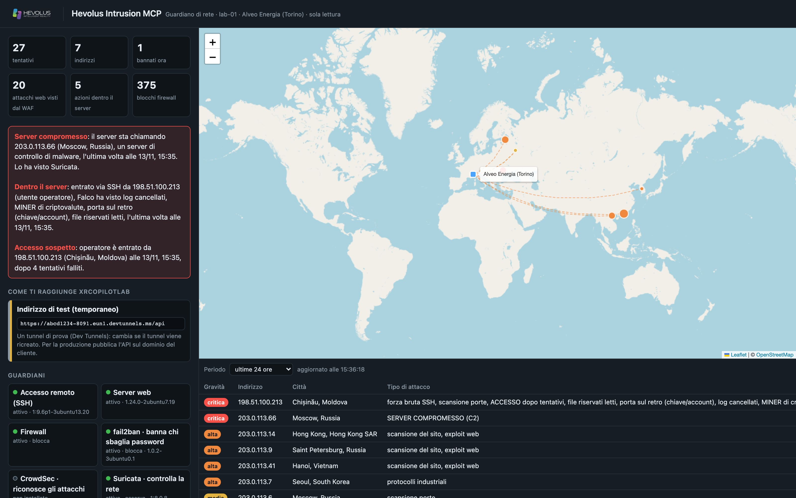
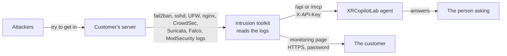
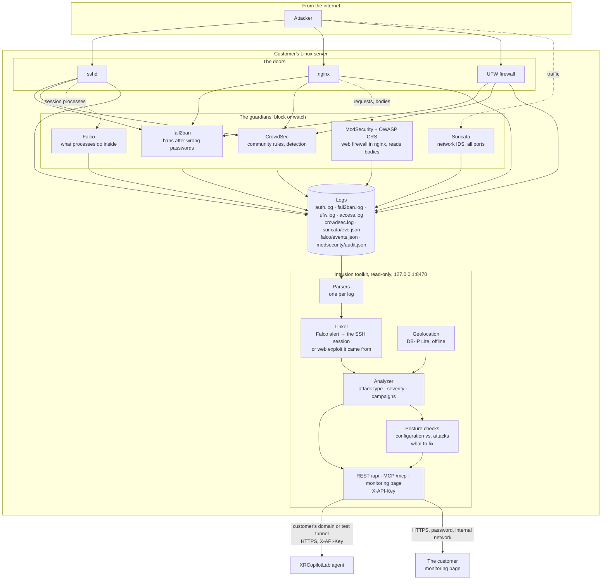
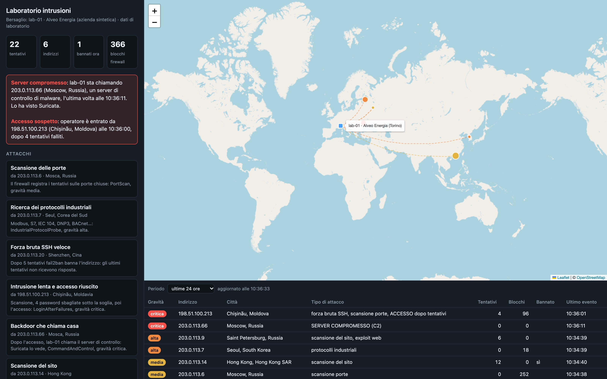
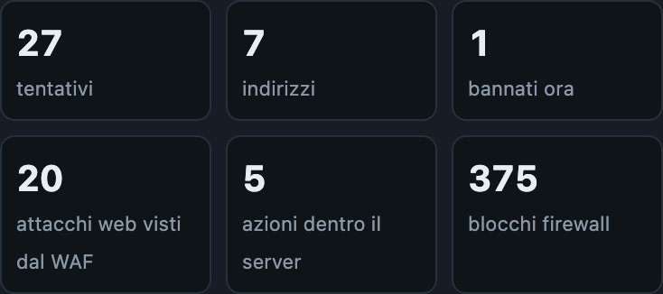
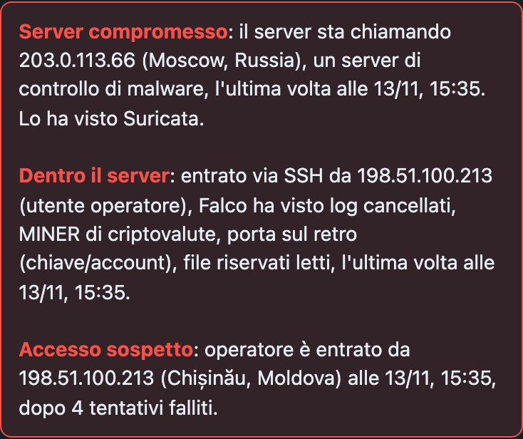
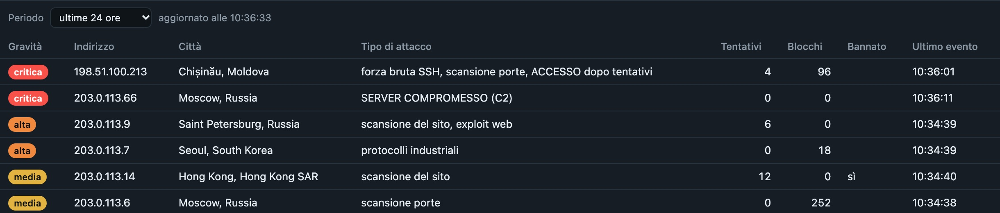
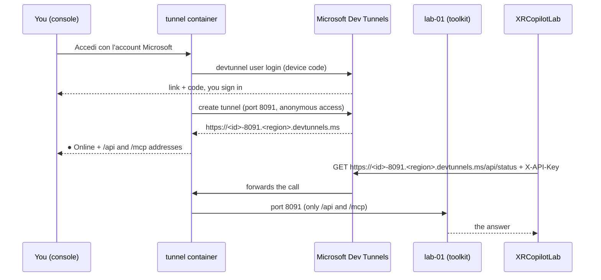

# xrcopilotlab-intrusion-mcp

**In plain words:** a small program, installed on a customer's Linux server, that tells an XRCopilotLab agent who is
trying to break into that server. The agent can then answer questions like *"Is anyone attacking us tonight?"*,
*"Where do the attacks come from?"*, *"Did anybody actually get in?"*.

It only **reads** and never changes anything. The server already has its own guards (fail2ban, the UFW firewall,
nginx, CrowdSec, Suricata, Falco): they block or watch the attackers and write what they saw in their logs. This
program reads those logs, understands what kind of attack each line is, finds the city each address comes from, ties
what an intruder did *inside* the server to the address they came from, and answers the agent. It also comes with a
read-only **monitoring page** and, for the agent, the server's security **configuration and a list of what to fix**.



*The monitoring page (here on the Docker lab's server, after `make lab-up` and a round of attacks): on the left the
numbers, what went wrong, how XRCopilotLab reaches the server and the guardians; on the right the map of the attackers
and the table of what the toolkit saw. Addresses in this picture are examples.*



## Contents

- [How it works (architecture)](#how-it-works-architecture)
- [What it reads: the security packages](#what-it-reads-the-security-packages)
  ([what could come next](#more-guardians-what-could-come-next), [full analysis](docs/security-tools.md))
- [The test console (Docker lab)](#the-test-console-docker-lab)
- [Install the toolkit on a customer's server](#install-the-toolkit-on-a-customers-server)
  (incl. [the monitoring page](#5-the-monitoring-page))
- [The lab on a domain (stable address)](#the-lab-on-a-domain-stable-address), or else
  [a public test address for XRCopilotLab (dynamic URL)](#a-public-test-address-for-xrcopilotlab-dynamic-url)
- [Commands (make)](#commands-make)
- [Tools](#tools), [Attack types](#attack-types), [The simulated host](#the-simulated-host),
  [Authentication](#authentication), [Configuration](#configuration)
- [Register it in XRCopilotLab](#register-it-in-xrcopilotlab)

---

## How it works (architecture)



In order:

1. **The doors** (SSH, the website, the firewall) write every attempt in their logs.
2. **The guardians** react or watch: fail2ban bans, CrowdSec spots slow attacks, **Suricata** checks all the network
   traffic against known attacks, **Falco** watches what programs do inside the server, **ModSecurity** (OWASP CRS, in
   nginx) reads every web request, POST bodies included. Each writes its own log.
3. **The toolkit** reads those logs at every question (it keeps nothing and writes nothing):
   - a **parser** per log turns each line into an event;
   - the **linker** ties a Falco alert, which has no address, to the attacker: the address of the SSH session the
     program was started in (`SSH_CLIENT`), the account that logged in (also through `sudo`), or the address that sent
     a web exploit just before a shell appeared under nginx;
   - the **analyzer** groups the events by address, names the attack type and grades the severity;
   - the **geolocation** puts each address on a city, from a file on the server (no outside service is called).
4. The **posture checks** read the host's own configuration (which guardians run, in which mode, which ports are open,
   how SSH is set) against the attacks of the period, and list what to fix, each with the command that fixes it.
5. **XRCopilotLab** asks over HTTPS, with a key, on the customer's own domain when one is set (a temporary test tunnel
   otherwise), and the agent answers the person in plain words. The customer sees the same data on a read-only
   **monitoring page**, served by nginx with a password, on the internal network only.

Nothing is installed on the server unless asked (`install.sh --with …`), and nothing ever blocks traffic on the
toolkit's initiative.

---

## What it reads: the security packages

The toolkit does not watch the network itself: it reads what the server's **security packages** (the "guardians")
write. Each one guards a different door; together they tell the whole story.

| Package | What it is for, in plain words | Log it writes | What the toolkit learns from it |
|---|---|---|---|
| **fail2ban** | The bouncer: after too many wrong passwords it blocks the address for a while | `/var/log/fail2ban.log` | Who was banned, when, by which rule ("jail"); repeat offenders (`recidive`) |
| **sshd** (OpenSSH) | The remote-login door of the server | `/var/log/auth.log` | Wrong passwords, accounts tried, and **who actually got in** |
| **UFW** | The firewall: closes every port that is not needed | `/var/log/ufw.log` | Knocks on closed doors: port scans, searches for industrial protocols (Modbus, S7…) |
| **nginx** | The web server | `/var/log/nginx/access.log` | What a web attacker asked for: `.env`, WordPress, SQL injection, Log4Shell… |
| **CrowdSec** | A community "neighbourhood watch": shared rules that spot attacks fail2ban misses, such as a very slow brute force | `/var/log/crowdsec.log` | Its alerts and decisions |
| **Suricata** | A network "metal detector": checks **all** traffic, on every port, against tens of thousands of known attack signatures (free ET Open rules) | `/var/log/suricata/eve.json` | Exploits against any service, addresses on public blacklists, industrial protocol commands, and above all **the server itself calling a malware controller**: proof that an intrusion went further than a login |
| **Falco** | A CCTV camera **inside** the server: watches what programs do, through the kernel (eBPF) | `/var/log/falco/events.json` | What an intruder did **after** getting in: read `/etc/shadow` or private keys, added an SSH key or an account, started a crypto miner, cleared the logs, a shell started by the web server. Tied to the address that got in |
| **ModSecurity + OWASP CRS** | A web application firewall **inside** nginx: reads the **whole** request, POST bodies included, against the OWASP Core Rule Set | `/var/log/modsecurity/audit.json` | Web attacks the access log cannot show, because they hide in the request body: SQL injection, XSS, command injection, path traversal, with the CRS rule and an anomaly score. In detection only: it never blocks |

A detector the host does not have is simply absent from the answers.

| Mode | Where it runs | What it reads | Use |
|---|---|---|---|
| `simulated` | Our Azure Container App `hev-intrusion-mcp` | A synthetic host generated in memory | Demos (ALVEO) |
| `logs` | The customer's host, next to its detectors | The eight logs above | Production |

Two faces, same key, same answers: **MCP** on `/mcp` (for whoever registers the server in XRCopilotLab by hand) and
**REST** on `/api` (for a blueprint, which provisions it as a `kind: builder` server with no manual step).

Both modes go through the same parsers and rules: the simulated host writes real-format log lines, and the server
reads them exactly as it reads a real host.

### More guardians: what could come next

We analysed other open-source security tools the toolkit could read; the full analysis, with licences, log formats,
costs and sources, is in [docs/security-tools.md](docs/security-tools.md). In short:

| Package | What it is for, in plain words | Verdict |
|---|---|---|
| **Suricata** | A network "metal detector": checks **all** traffic against thousands of known attack signatures (free ET Open rules), on every port, and sees a hacked server calling home (malware, C2). Knows Modbus, DNP3, ENIP | **Done in 0.2.0**: read, and installed by `--with suricata` |
| **Falco** | A CCTV inside the server: notices what happens **after** a break-in (nginx starting a shell, someone reading `/etc/shadow`, an SSH key added, a miner) | **Done in 0.3.0**: read, tied to the attacker's address, and installed by `--with falco` |
| auditd | The Linux kernel's own register of who did what; Falco's alternative using only Ubuntu packages | Fallback for Falco (L: hard log format) |
| **ModSecurity + OWASP CRS** | A web firewall in nginx that reads the **whole** request (also POST bodies), in detection-only mode | **Done in 0.4.0**: read, installed by `--with modsecurity`, excludes the toolkit's own API |
| Apache, Postfix/Dovecot, OpenVPN, sshguard, `sudo` lines | More doors many servers have: other web server, mail, VPN, another SSH bouncer, administrator commands | Quick wins, no new software (S) |
| Zeek + CISA ICSNPP | Deep view of industrial protocols (S7, Modbus, DNP3, BACnet) | Only on a separate sensor in the **plant network**, not on a public server (L) |
| Wazuh / OSSEC | A complete security platform (SIEM) | Read it only where the customer already has it; never installed by us |
| AIDE | Notices files that changed when they should not | Later (S–M) |
| ClamAV | Antivirus for files and web shells | Later: needs about 1 GB of RAM |
| Lynis, rkhunter, chkrootkit | Hardening check, rootkit search | Low priority: posture, not attacks; many false alarms |
| Snort 3, Malcolm, GRASSMARLIN, WireGuard | — | No: rules need a commercial licence / too heavy / archived / writes no log |

**Installing the guardians.** The package reads the guardians the server already has. If some are missing,
`sudo ./install.sh --with fail2ban,crowdsec,suricata,falco,modsecurity` also installs and configures the ones you name, idempotently and
only when asked (see [Install it](#2-install-it)). UFW is never switched on by the script: a firewall turned on by
mistake can lock everyone out of SSH.

---

## The test console (Docker lab)

To see the toolkit at work without a customer's server, `make up` starts a small lab on your computer, all in Docker:

- **`server`** (container `intrusion-lab-01`, host `lab-01`), a fake company server (Ubuntu, "Alveo Energia" in Turin) with SSH, a website, fail2ban, a firewall, Suricata, Falco and ModSecurity,
  and **the same toolkit package a customer installs**, installed by the same `install.sh`; its API is also on
  **http://localhost:8091** (`/api`, `/mcp`, with the `X-API-Key` in `lab/.env`), to try a client from the Mac;
- **`metasploit`** (container `intrusion-lab-metasploit`), a real attack engine the console drives for three of the attacks;
- **`attacker`** (container `intrusion-lab-attacker`), which attacks `lab-01` when you press a button, and serves the console on
  **http://localhost:8090**: only the attacks, the tunnel and the server to test;
- **`tunnel`** (container `intrusion-lab-tunnel`), which gives `lab-01` a public HTTPS address, so XRCopilotLab can call it (see
  [below](#a-public-test-address-for-xrcopilotlab-dynamic-url)).



The attacks never leave the lab: all addresses are "documentation" addresses (RFC 5737) that no real computer uses,
and each one gets an invented city so that the map has something to show.

What the toolkit sees (the numbers, the red box, the map and the table below) is on `lab-01`'s own **monitoring page**,
the same a customer gets (see [The monitoring page](#5-the-monitoring-page)), with the Hevolus logo at the top. It
opens **only through the Dev Tunnel**, with your Microsoft account: once the tunnel is online, the console's button
*Mappa e lista degli attacchi* opens it (see [below](#a-public-test-address-for-xrcopilotlab-dynamic-url)). No
password of its own.

### The numbers



| Number | What it means |
|---|---|
| **tentativi** | Attempts in the period: wrong passwords, suspicious web requests, … |
| **indirizzi** | How many different addresses attacked |
| **bannati ora** | Addresses blocked right now by fail2ban |
| **attacchi web visti dal WAF** | Requests ModSecurity (OWASP CRS) recognised as attacks, bodies included |
| **azioni dentro il server** | What Falco saw happen inside the server (files read, accounts or keys added, miners, logs wiped) |
| **blocchi firewall** | Connections the firewall refused on closed ports |

Under the numbers, a red box appears when something serious happens:



- **Server compromesso**: Suricata saw `lab-01` itself calling a malware controller. The intrusion went further than a
  login: someone left a program that takes orders from outside.
- **Dentro il server**: Falco saw what the intruder did once in (here: read the passwords file, added an SSH key to
  come back, started a crypto miner, cleared the login records), and the toolkit tied it to the address that got in.
- **Accesso sospetto**: someone got in after guessing the password.

### The attacks


Each card is a real attack, run against `lab-01` when you click it; the box *"Cosa sta facendo l'attaccante"* shows,
line by line, the commands the attacker runs (nmap, ssh, curl…) and what happens.

| Attack | From | What the toolkit should see |
|---|---|---|
| Scansione delle porte | 203.0.113.6 (Moscow) | Port scan, medium |
| Ricerca dei protocolli industriali | 203.0.113.7 (Seoul) | Probe of Modbus, S7, IEC 104, DNP3, BACnet… high |
| Forza bruta SSH veloce | 203.0.113.20 (Shenzhen) | SSH brute force, banned by fail2ban after 5 tries |
| Intrusione lenta e accesso riuscito | 198.51.100.213 (Chișinău) | Scan, slow password guessing under fail2ban's limit, then **a login**: critical |
| Scansione del sito | 203.0.113.14 (Hong Kong) | Requests for `.env`, `.git`, WordPress, phpMyAdmin: banned |
| Tentativi di exploit web | 203.0.113.9 (Saint Petersburg) | SQL injection, path traversal, Log4Shell…: high |
| Forza bruta sull'area riservata | 203.0.113.18 (São Paulo) | Wrong passwords on `/admin/`: banned |
| Flood di richieste | 203.0.113.15 (Dallas) | Too many requests (429): banned |
| Campagna distribuita su un account | 192.0.2.11–22 (12 cities) | 12 addresses, 2 tries each on one account: no ban, but a campaign |
| L'intruso dentro il server | 198.51.100.213 (Chișinău) | Once in, the intruder looks for private keys, reads `/etc/shadow` with `sudo`, adds an SSH key, starts a "miner", empties `wtmp`. **Falco** sees each step; the toolkit ties them to 198.51.100.213: `SensitiveFileAccess`, `Persistence`, `CryptoMining`, `LogTampering`, and the box "Dentro il server" |
| Backdoor che chiama casa | 203.0.113.66 (Moscow) | The intruder logs in and leaves a backdoor; `lab-01` calls its controller three times. **Suricata** sees it: `CommandAndControl`, critical, and a red box "Server compromesso" in the console |
| La notte completa | all of them | All the above in sequence, about three minutes: the best demo |

### The map


The blue square is `lab-01` (Turin). Every dot is an attacking address, placed on its city; the dashed line goes from
the attacker to the server. The colour is the severity: **red** critical, **orange** high, **yellow** medium. The map
is OpenStreetMap: drag and zoom it as any online map.

### The table



One row per attacking address, most serious first:

| Column | What it means |
|---|---|
| **Gravità** | `critica` (someone got in), `alta`, `media`, `bassa` |
| **Indirizzo / Città** | Who attacked, and from where |
| **Tipo di attacco** | What they tried, in words (SSH brute force, site scan, web exploit, …) |
| **Tentativi** | How many tries |
| **Blocchi** | How many connections the firewall refused |
| **Bannato** | `sì` if fail2ban is blocking that address now |
| **Ultimo evento** | When it last did something |

**Periodo** changes the window: last hour, last 24 hours, last week. The page refreshes by itself.

---

## Install the toolkit on a customer's server

What the customer gets is **one file**, a `.tar.gz` package with everything inside: the program (a single file, no
.NET to install), the systemd service and the install script.

### 1. Get the package

Download it from the release page, **https://github.com/hevolusinnovation/xrcopilotlab-intrusion-mcp/releases/latest**
(the repository is private: you need a Hevolus GitHub account). There are two packages; pick the one for the server's
processor (`uname -m` on the server: `x86_64` → x64, `aarch64` → arm64):

| File | Server |
|---|---|
| `xrcopilotlab-intrusion-mcp-<version>-linux-x64.tar.gz` | Intel/AMD (most servers and cloud VMs) |
| `xrcopilotlab-intrusion-mcp-<version>-linux-arm64.tar.gz` | ARM (Azure Ampere, AWS Graviton, Raspberry Pi 64-bit) |
| `SHA256SUMS` | Fingerprints, to check the download: `sha256sum -c SHA256SUMS --ignore-missing` |

From the command line, and straight to the server:

```bash
gh release download v0.5.1 -R hevolusinnovation/xrcopilotlab-intrusion-mcp -p '*linux-x64.tar.gz' -p SHA256SUMS
scp xrcopilotlab-intrusion-mcp-0.5.1-linux-x64.tar.gz SHA256SUMS admin@<server>:/tmp/
```

Or build it from this repository: `make package VERSION=0.5.1` (add `RID=linux-arm64` for ARM); the file lands in
`out/`.

### 2. Install it

On the server (Debian or Ubuntu, with fail2ban already running):

```bash
cd /tmp
sha256sum -c SHA256SUMS --ignore-missing
tar -xzf xrcopilotlab-intrusion-mcp-0.5.1-linux-x64.tar.gz
cd xrcopilotlab-intrusion-mcp-0.5.1-linux-x64
sudo ./install.sh
```

The script asks for the **key** XRCopilotLab will send (at least 24 characters; it can also come from
`INTRUSION_MCP_API_KEY`). It keeps only the key's fingerprint (SHA-256), never the key itself. Then it:

- checks that the package is for this server's processor, before touching anything;
- installs `libicu` if missing (the only system library it needs);
- copies the program to `/opt/xrcopilotlab-intrusion-mcp/`, the key's fingerprint to `/etc/xrcopilotlab-intrusion-mcp/env`;
- creates the user `xrcopilot-intrusion`, who can read `/var/log` and nothing else (read-only system);
- starts the service `xrcopilotlab-intrusion-mcp` and waits until it answers.

**Run it again whenever you like: it is idempotent.** A second run, or a newer version, gives the same result as a first
install and never asks twice:

| On a second run | What happens |
|---|---|
| The key | **kept**; `sudo ./install.sh --new-key` replaces it (the old one stops working) |
| `appsettings.Production.json` | **kept** if you changed it; the new defaults go next to it as `appsettings.Production.json.new` |
| The DB-IP file in `geo/` | kept |
| The program and the service | replaced, then the service restarts with the new version (`upgrading 0.2.0 -> 0.3.0`) |
| User, folders, `libicu` | created only if missing |

**The server's name, place and public address** (optional) are given the same way, as variables:

```bash
sudo SITE_NAME="Officina Rossi (Bari)" SITE_LATITUDE=41.117 SITE_LONGITUDE=16.871 \
     PUBLIC_URL=https://guardiano.cliente.it/intrusion-mcp ./install.sh
```

| Variable | What it does |
|---|---|
| `SITE_NAME` | The name at the top of the monitoring page and on the map; without it, the host name only |
| `SITE_LATITUDE`, `SITE_LONGITUDE` | The server's place on the map, decimal degrees (both or neither) |
| `PUBLIC_URL` | The address XRCopilotLab uses, on the customer's domain (`https://…`): the DNS name, nginx with TLS and the firewall must already be in place (see [Where it answers](#3-where-it-answers)) |

They go to `/etc/xrcopilotlab-intrusion-mcp/site.env`, checked first (a wrong value stops the script before the
file is written). A later run that gives none of them keeps the file; one that gives any of them rewrites it whole, so
give them all again. Remove the file to forget them.

Options: `--new-key` (replace the key), `--no-start` (install without starting, for images built ahead), and
`--with` to install the security packages the server does not have yet:

```bash
sudo ./install.sh --with fail2ban,crowdsec,suricata,falco,modsecurity   # any of them, in any order
```

| Package | What `--with` does (and does again, the same way, on every run) |
|---|---|
| `fail2ban` | Installs it from the distribution, with the `sshd` jail on |
| `crowdsec` | Installs it from CrowdSec's own repository (the distribution's is years old), **detection only**: no bouncer, it blocks nothing; makes its log readable by the group `adm` |
| `suricata` | Installs Suricata 8 from the OISF repository (Ubuntu's 7.0 is out of support) as an **IDS**: it watches, it never drops traffic. Downloads the ET Open rules and updates them every night (timer `xrcopilotlab-suricata-update`); listens on the interface of the default route, or without one on the first interface with an address (`SURICATA_INTERFACE=…` to choose another); puts the server's own addresses in `HOME_NET`, without which most rules never fire on a public server; writes **only alerts** to `eve.json` (the package default logs every connection, DNS query and TLS handshake in the same file); rotates the logs every day for a week; lets the toolkit read them. The OISF repository is added by hand, with its keys checked by fingerprint: `add-apt-repository` depends on Launchpad's API, which can fail for hours |
| `falco` | Installs Falco from its own repository with the **modern eBPF probe** (no kernel module, no compiler, nothing to rebuild at a kernel upgrade). Writes alerts as JSON to `/var/log/falco/events.json` (readable by the group `adm`, rotated daily for a week), adds to each alert the SSH client address, the `sudo` user and the process tree (so the toolkit can tie it to the attacker), and adds three rules Falco has not got for a plain server: **SSH key added**, **account created or changed**, **crypto miner started**. It watches; it never kills a process |
| `modsecurity` | Needs nginx. Installs the ModSecurity v3 nginx module and the OWASP Core Rule Set, in **detection only** (`SecRuleEngine DetectionOnly`): it reads every request, bodies included, and writes the ones the CRS would block to `/var/log/modsecurity/audit.json` (JSON, readable by `adm`, rotated with `copytruncate`), but blocks nothing. Switched on for every site with one file in `conf.d` (a site with `modsecurity off;` stays off); the toolkit's own API and the monitoring page are excluded. `nginx -t` is run before and after: if it fails, the file is removed and nginx is left untouched. The package's own rule loader uses a directive ModSecurity v3 rejects, so the CRS files are included one by one |

**Suricata needs memory:** about 1.5 GB with all the ET Open rules (measured in the lab). Install it on servers with
4 GB or more, or trim the rules first (`/etc/suricata/disable.conf`, then `suricata-update`).

**ModSecurity** costs about 17 MB of RAM per nginx worker and under 1 ms per request (measured in the lab, paranoia
level 1); it needs nginx.

**Falco needs** a kernel with BTF (`ls /sys/kernel/btf/vmlinux`: Ubuntu 22.04 and later have it) and about 230 MB of
RAM (measured in the lab).

A package that is already there is configured, not reinstalled. Suricata's and Falco's configuration is changed only
if `install.sh` installed them: a Suricata or Falco the customer already runs is read as it is (for Falco, turn on
`json_output` and a `file_output` to `/var/log/falco/events.json`).

### 3. Where it answers

| Address | Who uses it |
|---|---|
| `http://127.0.0.1:8470` | The toolkit itself, **only from inside the server**: nobody outside can reach it. Not 8080: CrowdSec's local API is there |
| `https://<server>/intrusion-mcp/api` | XRCopilotLab, from a blueprint (connection with HTTP tools) |
| `https://<server>/intrusion-mcp/mcp` | XRCopilotLab, as an MCP server registered by hand |

The two public addresses go through the nginx already on the server, with its HTTPS certificate. The install script
prints the block to add, which also lets in only XRCopilotLab's addresses:

```nginx
location /intrusion-mcp/ {
    modsecurity off;                 # with --with modsecurity: don't inspect the toolkit's own API
    allow <XRCopilotLab address>;
    deny  all;
    proxy_pass http://127.0.0.1:8470/;
    proxy_http_version 1.1;
    proxy_buffering off;
}
```

For production, give the customer's own address to `install.sh` (`PUBLIC_URL=…`, see [Install it](#2-install-it)) so
the agent (and the monitoring page) show it; it can also be set in `appsettings.Production.json` as
`"Connection": { "PublicUrl": "https://guardiano.cliente.it/intrusion-mcp" }`. Without it, the agent uses a
temporary test tunnel if one is open, and the page says so.

### 4. Check it

```bash
curl -s http://127.0.0.1:8470/healthz                                      # on the server
curl -s https://<server>/intrusion-mcp/api/status -H "X-API-Key: <key>"     # from outside
systemctl status xrcopilotlab-intrusion-mcp                                 # the service
journalctl -u xrcopilotlab-intrusion-mcp -f                                 # its log
```

### 5. The monitoring page


`install.sh` also publishes a **read-only monitoring page** (unless you pass `--no-dashboard`): nginx serves it on
**`https://<server>:8471`**, with a password (user `admin`, a password printed once at install; change it by removing
`/etc/nginx/xrcopilotlab-dashboard/htpasswd` and running `install.sh` again), reachable from the internal network only
(`DASHBOARD_ALLOW` to change). It shows the map, the guardians with a traffic light each, "what to fix" in plain words,
and how XRCopilotLab reaches the server. It only reads: it never bans, blocks or changes anything, and the commands it
suggests are for a person to run. The page reads the toolkit's API with a key of its own that the browser never sees.

**Cities on the map (optional):** download the free DB-IP "IP to City Lite" file (https://db-ip.com/db/lite.php),
save it as `/opt/xrcopilotlab-intrusion-mcp/geo/dbip-city-lite.csv.gz` and run
`sudo systemctl restart xrcopilotlab-intrusion-mcp`. Without it everything works, but without places.

Tried in the Docker lab (first install and repeated runs), not yet on a customer's server. Two things to check there: that `/var/log/crowdsec.log` is
readable by the group `adm`, and the exact line format of the server's CrowdSec version.

---

## The lab on a domain (stable address)

When the lab runs on a machine that has a name on the internet (a server, a VM), XRCopilotLab and the monitoring page
can use that name instead of a Dev Tunnel. It is set in **`lab/.env`** (example: [`lab/.env.example`](lab/.env.example)):

```bash
PUBLIC_DOMAIN=intrusion-lab.example.com   # empty: no domain, the console opens a Dev Tunnel (next section)
PUBLIC_PAGE_PORT=8443                      # the public port of the monitoring page
```

In the same file, `SITE_NAME`, `SITE_LATITUDE` and `SITE_LONGITUDE` set the name and the place the page shows (the
lab's company, *Alveo Energia (Torino)*, is invented; on a real server the same variables go to `install.sh`).

then `make lab-up` (or `make lab-restart` if it was running). The console then shows **● Dominio** with the addresses
to copy into XRCopilotLab, and no Dev Tunnel is opened.

**This assumes the infrastructure is already in place: the lab does none of it.** Before setting `PUBLIC_DOMAIN`:

| What | Where |
|---|---|
| The DNS name (`A`/`AAAA` record, or `CNAME`) points to the machine running the lab | DNS of the domain |
| A reverse proxy with a valid TLS certificate for that name: `https://<domain>/` → `http://<machine>:8091` (API: `/api`, `/mcp`) and `https://<domain>:<PUBLIC_PAGE_PORT>/` → `http://<machine>:8093` (monitoring page) | nginx, Caddy, Azure Application Gateway, … |
| Ports 443 and `PUBLIC_PAGE_PORT` open from the internet to the proxy (443 from XRCopilotLab's addresses at least); 8091 and 8093 open **only** from the proxy to the machine | firewall / NSG |
| Who may open the monitoring page: on a domain the page has **no login of its own** (the Dev Tunnel's Microsoft login is not there), so restrict it at the proxy: VPN, office addresses, or the proxy's own sign-in (e.g. Entra ID) | reverse proxy |

With `PUBLIC_DOMAIN` set, the lab publishes `lab-01`'s port 8091 (`/api`, `/mcp`, every call needs the `X-API-Key`)
and 8093 (the read-only page) on the machine, plain HTTP, for the proxy (`lab/docker-compose.domain.yml`), and the
package on `lab-01` reports `https://<domain>` as its address (`Connection:PublicUrl`): the page shows it as
*Dominio del cliente*. *Verifica dall'indirizzo pubblico* in the console calls `https://<domain>/api/status`, as
XRCopilotLab will: if it fails, the DNS, the proxy or the firewall is not ready yet.

## A public test address for XRCopilotLab (dynamic URL)

Without `PUBLIC_DOMAIN` (the default), the lab gets a temporary public address for tests. The lab runs on your laptop, but XRCopilotLab runs in the cloud: it needs a public address to reach `lab-01`. The
`tunnel` container creates one with **Microsoft Dev Tunnels**, free, and you do everything from the console: nothing to
install on the Mac.


*Addresses and account in this picture are examples.*

### How the address is created

1. In the console, box **Collegamento a XRCopilotLab**, click **Accedi con l'account Microsoft**.
2. The console shows a Microsoft link (`https://microsoft.com/devicelogin`) and a **code**: open the link, enter the
   code and sign in with your Hevolus (Entra ID), Microsoft or GitHub account.
3. The console notices the login by itself; the `tunnel` container creates a tunnel and opens it. After a few seconds
   the box says **● Online** and shows the addresses.
4. Copy the addresses and the key with the **Copia** buttons, and paste them in XRCopilotLab.
5. **Verifica dall'indirizzo pubblico** calls `lab-01` through the public address, as XRCopilotLab will: if it says
   ok, the connection works.



### What the address looks like

```
https://<id>-8091.<region>.devtunnels.ms/api    connection with HTTP tools (blueprint)
https://<id>-8091.<region>.devtunnels.ms/mcp    MCP server registered by hand
X-API-Key: <the lab key>                        header, from "Copia la chiave"
https://<id>-8093.<region>.devtunnels.ms/       monitoring page (map and attacks), Microsoft login
```

`<id>` is the tunnel's name, chosen by Microsoft; `8091` is `lab-01`'s port; `<region>` is the closest Microsoft region
(for example `eun1`, North Europe).

### How long it lasts

| Action | The address |
|---|---|
| `make down`, then `make up` | **stays the same**: login and tunnel are kept (Docker volume `tunnel-login`) |
| Unused for 30 days | expires: the next start creates a new one |
| **Esci** in the console | closes the tunnel; signing in again with the same account gives back the same address, with another account a new one |
| `make lab-reset` | is forgotten: the next login creates a new address |

### Is it safe?

- The tunnel reaches **only** `/api` and `/mcp` of the toolkit on `lab-01`, and its read-only monitoring page: not SSH, not the website, not the console.
- The API port (8091) has anonymous access (XRCopilotLab cannot sign in to Microsoft), but **every call still needs the key**.
- The monitoring page (port 8093) has no anonymous access: Dev Tunnels asks for the Microsoft login and lets in only
  the account that opened the tunnel and its Entra tenant (Hevolus). It only reads.
- The key is in `lab/.env` (never committed); the browser never sees it unless you press *Copia la chiave*.
- Dev Tunnels is for development and tests (limits: 5 GB of traffic and 10 tunnels per user per month). **Never use
  it for a customer's server**: there, the toolkit is published by the customer's nginx, as described above.

---

## Commands (make)

`make help` prints them all.

| Command | What it does |
|---|---|
| `make up` | Builds and starts the lab; console on http://localhost:8090 (creates `lab/.env` with the lab key the first time) |
| `make down` | Stops the lab; keeps the tunnel login (same public address next time) |
| `make lab-build` | Builds the lab images without starting them |
| `make lab-restart` | Stops and starts again, rebuilding what changed |
| `make lab-rebuild` | Rebuilds the images from scratch and restarts |
| `make lab-ps` | Which containers are running, and whether they are healthy |
| `make lab-logs` | Follows the logs; `SVC=server`, `attacker`, `tunnel` or `metasploit` for one container |
| `make lab-shell` | Opens a shell in the server `lab-01` (or `SVC=…`); same as `docker exec -it intrusion-lab-01 bash` |
| `make lab-open` | Opens the console in the browser |
| `make lab-reset` | Stops the lab and deletes everything, tunnel login included |
| `make build` / `make test` | Builds the solution / runs the unit tests |
| `make run` | The toolkit on your Mac, simulated mode, on http://localhost:5290 (needs `INTRUSION_MCP_API_KEY`) |
| `make package VERSION=…` | The package for a customer's server, in `out/` |
| `make docker-build` / `docker-push` / `deploy` / `smoke` `TAG=…` | The demo on Azure (simulated mode) |
| `make key` | Prints the SHA-256 of a key typed in the terminal |

More on the lab (how the firewall logs are produced, what the lab found in the package): [lab/README.md](lab/README.md).

---

## Tools

All tools are read-only (`readOnlyHint: true`). Every answer carries `simulated` and the geolocation attribution.
The period is the last 24 hours by default (`hours`, max 720), or `since`/`until` in ISO 8601.

| Tool | Answers |
|---|---|
| `intrusion_status` | Active jails, addresses banned now per jail, bans and attempts in the last 24 h, latest event. |
| `intrusion_banned_ips` | Addresses banned now: jail, attack type, since when, location. Filter by `jail`. |
| `intrusion_attempts` | One row per source address, most serious first: attempts, bans, accounts tried, attack types, severity, location, Suricata signatures, and what Falco saw it do inside (`hostActivity`). Filters: `jail`, `attackType`, `country`, `top`. |
| `intrusion_ip_detail` | Everything one address did: summary, suspicious logins, timeline (up to 200 events), including the Falco alerts of the session it opened. |
| `intrusion_suspicious_logins` | Successful SSH logins after repeated failures (Critical) or from an unexpected country (High). |
| `intrusion_summary` | Totals, by attack type, by country, most targeted closed ports, top attackers, distributed campaigns, suspicious logins, map points (lat/lon/severity) for a map, the latest Falco alerts on the host. |
| `intrusion_host_activity` | What happened **inside** the server (Falco): each alert with its rule, attack type, severity, account, command, file, and the address it was tied to (`ssh-session` or `web-exploit`) or none. Filters: `attackType`, `unlinkedOnly`. |
| `intrusion_guardians` | The server's protection as configured now: each guardian with its role, status (ok / stopped / log-unreadable / missing), version, mode (detection or blocking); the TCP ports open to the network; sshd's settings; and how XRCopilotLab reaches the server (the customer's domain, or a temporary test tunnel). |
| `intrusion_posture` | Checks of the configuration against the attacks of the period: incidents first (someone got in), then SSH with passwords, services and industrial ports open to the network, a slow brute force nobody banned, no web firewall, guardians stopped, old rules. Each finding has a severity, the evidence, a recommendation and — when this package can do it — the command that fixes it. Nothing is applied: it is the material for a security plan. |

REST, same parameters as query strings: `GET /api/status`, `/api/banned?jail=`, `/api/attempts?hours=&jail=&attackType=&country=&top=`,
`/api/ips/{ip}?hours=`, `/api/suspicious-logins?hours=`, `/api/summary?hours=&top=`, `/api/host-activity?hours=&attackType=&unlinkedOnly=`.

### Attack types

| Type | From |
|---|---|
| `SshBruteForce` | sshd failures from one address (3 or more, or an sshd ban) |
| `DistributedSshBruteForce` | One account tried by 8+ addresses, each with 4 failures at most, trying nothing else: fail2ban alone never bans them |
| `WebLoginBruteForce` | Jails `nginx-http-auth`, `apache-auth`, `wordpress`, …; nginx 401; CrowdSec `http-*-bf` |
| `WebVulnerabilityScan` | Jails `nginx-botsearch`, …; nginx requests for `/.env`, `/.git/`, WordPress, phpMyAdmin, admin consoles, backups, web shells, `cgi-bin`, scanner user agents; CrowdSec `http-probing`, `http-sensitive-files`, … |
| `WebExploitAttempt` | nginx requests with SQL injection, path traversal, command injection, Log4Shell, PHPUnit RCE; CrowdSec `*-cve-*`, `http-sqli-probing`, … |
| `RequestFlood` | Jails `nginx-limit-req`, `apache-modsecurity`; nginx 429 |
| `MailLoginBruteForce` | Jails `postfix-sasl`, `dovecot`, … |
| `PortScan` | 10+ distinct closed ports from one address (UFW); CrowdSec `iptables-scan-multi_ports` |
| `IndustrialProtocolProbe` | Any connection to Modbus 502, S7 102, IEC 104 2404, DNP3 20000, EtherNet/IP 44818, OPC UA 4840, BACnet 47808, Niagara Fox 1911 |
| `RepeatOffender` | Banned by the `recidive` jail |
| `LoginAfterFailures` | An `Accepted …` login after 3+ failures from the same address in the previous 24 h: possible compromise |
| `NetworkExploitAttempt` | Suricata: `ET EXPLOIT …` and the other attack signatures on a service that is not the web (SSH, SMB, databases…) |
| `KnownMaliciousSource` | Suricata: the address is on a public blacklist (`ET DROP`, `ET CINS`, `ET COMPROMISED`, `ET DSHIELD` signatures) |
| `IndustrialProtocolCommand` | Suricata: Modbus, DNP3, EtherNet/IP, S7 traffic or `ET SCADA` signatures: someone talking to a plant system, not just knocking |
| `CommandAndControl` | Suricata: a malware signature on a connection **the server opened**: it is calling a malware controller, it is probably compromised. The address reported is the controller's |
| `SensitiveFileAccess` | Falco: `/etc/shadow` or other password and key files read by a program that has no reason to (*Read sensitive file untrusted*), a search for private keys (*Search Private Keys or Passwords*) |
| `SuspiciousExecution` | Falco: a shell started by the web server (*Run shell untrusted*: a web shell or command injection that worked), a program run from `/dev/shm`, a binary run from memory |
| `Persistence` | Falco: an SSH key written to `authorized_keys`, an account created or changed (rules added by `install.sh --with falco`) |
| `PrivilegeEscalation` | Falco: `ptrace` on another process, a kernel module loaded, a container escape |
| `LogTampering` | Falco: logs emptied or deleted (*Clear Log Activities*, *Remove Bulk Data from Disk*): someone covering their tracks |
| `CryptoMining` | Falco: a miner started (`xmrig` and the like, or a `stratum+tcp://` pool address on the command line) |

Suricata also adds `PortScan` (`ET SCAN …`), `WebExploitAttempt` (`ET WEB_…`, *Web Application Attack*) and
`RequestFlood` (*Denial of Service*). Only its priority 1 and 2 alerts are read: engine events and information
signatures (priority 3 and 4) say nothing about an attacker. Every answer lists the Suricata signatures of an address
(`idsSignatures`: name, id, category, priority, alerts, `outbound`).

**Falco alerts have no address of their own.** The toolkit ties each one to the attacker, in this order:

| How | When | `linkedBy` |
|---|---|---|
| The process's `SSH_CLIENT` | A program started in an SSH session: the client's address is in its environment. Exact | `ssh-session` |
| The web exploit just before | A program below nginx, php-fpm, Apache… (or run as `www-data`): the address that sent a web exploit in the hour before | `web-exploit` |
| The account's last login | Below `sudo` (which clears `SSH_CLIENT`) or without it: the last SSH login, in the 12 hours before, of the account that logged in (`user.loginname`, or `SUDO_USER`) | `ssh-session` |

An alert none of these explains (a cron job, a backup agent, an administrator at the console) stays **the host's**: it
is in `intrusion_host_activity` and in the summary, not in an attacker's row. Falco's informational rules, a terminal
opened in a container (an administrator's `docker exec`) and what the guardians do themselves (Suricata's capture
socket) are not read.

Severity: `Critical` (login after failures, the server calling a malware controller, an address that attacked **and**
then did something Falco reports, a miner, cleared logs, a web shell), `High` (anything else Falco reports for an
address, such as an ordinary login reading `/etc/shadow`; repeat offender,
industrial probe or command, web exploit, a priority-1 network exploit, login from an unexpected country), `Medium`
(any ban, a CrowdSec or Suricata alert, 10+ attempts, campaign, flood, web login brute force, port
scan), `Low` (the rest). A user who mistypes once and then logs in is not reported, nor are ordinary web visitors or
a few stray packets on the firewall.

One attempt is counted once: sshd failures from `auth.log` (fail2ban's `Found` only when `auth.log` is missing), web
requests from whichever of fail2ban and nginx saw more. Firewall blocks, CrowdSec, Suricata and Falco alerts are reported apart.

---

## The simulated host

`bastion-01`, an SSH and nginx host in Europe/Rome behind UFW, protected by fail2ban with `sshd` (5 tries in 10 min,
1 h ban), `nginx-http-auth`, `nginx-botsearch`, `nginx-limit-req` and `recidive` (3 bans in a day, 1 week), with
**CrowdSec in detection mode** (it alerts and decides, but no bouncer enforces), **Suricata** as an IDS and **Falco**
inside. Each day it
has:

- SSH brute force from 25-45 addresses, most of them banned; web vulnerability scans; web login brute force; web
  exploit attempts (SQL injection, path traversal, Log4Shell, PHPUnit, command injection);
- every fourth day, a request flood;
- firewall noise on closed ports (Telnet, RDP, SMB…), 2-4 port scans, and one probe of the industrial control ports;
- a **distributed campaign** on one account (`admin`, `scada`, `engineer`, `vpn` in rotation) from 14-25 home
  connections, none banned;
- one address banned three times, then by `recidive` for a week;
- **the intrusion**, from `198.51.100.213` (Chișinău): at 00:31 a port scan; from 00:52 one SSH try every 160-230 s on
  `operatore`, slow enough that fail2ban never bans it; around 01:25 CrowdSec raises `ssh-slow-bf`, which nothing
  enforces; around 02:50 a successful password login; 15-25 minutes later the server starts calling a malware
  controller, `203.0.113.66`, every ten minutes until morning, and Suricata reports each call. In between, **Falco**
  sees what the intruder does: looks for private keys, reads `/etc/shadow` through `sudo`, adds an SSH key, starts a
  backdoor and a miner from `/dev/shm`, empties `wtmp`; each step is tied to `198.51.100.213`. The agent sees the
  whole sequence, and could have acted at 00:31 or at 01:25;
- **Suricata** alerts: about one SSH attacker in three is on a public blacklist (`ET CINS …`), one or two addresses try
  an OpenSSH exploit, and a few engine events (priority 3) that must not be reported. The signature names follow ET
  Open's style, the signature ids are synthetic (9 000 000+);
- **Falco** also reports, every night at 04:12, an inventory agent run by cron that reads `/etc/shadow` as root: no
  login explains it, so it stays the host's (to tune, not an attacker); on some days a command injection works and
  nginx's php-fpm starts a shell, tied to the address that sent it (`web-exploit`);
- legitimate logins: the nightly `backup` key from the office (03:00), the `deploy` key in working hours, the
  administrator `m.ferri` who mistypes once at 09:xx; ordinary web visitors and a crawler.

Deterministic: the same seed and day give the same lines on every replica and after every restart. Today is cut at
the current time, so new attacks appear during the day. Settings: `Simulation:Hostname`, `Seed`, `Days` (30),
`TimeZone`, `IncidentEveryDays` (1).

**All data is synthetic.** Every address is in a documentation range (RFC 5737: `192.0.2.0/24`, `198.51.100.0/24`,
`203.0.113.0/24`), which no real host uses, with an invented city; networks carry documentation AS numbers
(RFC 5398). A test fails if a simulated address is anything else.

---

## Authentication

XRCopilotLab sends the key in the `X-API-Key` header. The server stores only its SHA-256 (`ApiKeys:Hash`, hex
lowercase); a second key for a rotation goes in `ApiKeys:Keys:n:Hash`. The key is accepted in the header only, never
in the query string, so it never ends up in the MCP server's address. `/healthz` answers 503 while no key is
configured; `/livez` answers when the process is up. 120 calls per minute per key.

---

## Configuration

| Key | Default | Meaning |
|---|---|---|
| `Server:Mode` | `logs` | `logs` or `simulated` |
| `ApiKeys:Hash` | — | SHA-256 of the key |
| `Logs:Fail2banFiles` | `/var/log/fail2ban.log*` | fail2ban logs; `*` takes the rotated copies, `.gz` included |
| `Logs:AuthFiles` | `/var/log/auth.log*` | sshd logs (`/var/log/secure*` on RHEL) |
| `Logs:FirewallFiles` | `/var/log/ufw.log*` | UFW logs (`ufw logging low` or higher) |
| `Logs:WebAccessFiles` | `/var/log/nginx/access.log*` | nginx access logs, `combined` format |
| `Logs:CrowdsecFiles` | `/var/log/crowdsec.log*` | CrowdSec logs |
| `Logs:SuricataFiles` | `/var/log/suricata/eve.json*` | Suricata EVE logs: only `event_type: alert`, priority 1 and 2 |
| `Logs:FalcoFiles` | `/var/log/falco/events.json*` | Falco JSON file output: alerts of priority Notice and above |
| `Logs:ModSecurityFiles` | `/var/log/modsecurity/audit.json*` | ModSecurity JSON audit log: web attacks the CRS would block |
| `Site:Name` / `Site:Latitude` / `Site:Longitude` | — | The server's name and place on the monitoring page's map (optional; `SITE_NAME`, `SITE_LATITUDE`, `SITE_LONGITUDE` at install) |
| `Connection:PublicUrl` | — | The customer's own public address for XRCopilotLab (`https://guardiano.cliente.it/intrusion-mcp`; `PUBLIC_URL` at install). When set, it is the address; without it a test tunnel gives a temporary one |
| `Connection:TunnelUrlFile` | `/var/lib/.../tunnel/url` | Where a test tunnel writes its temporary public address |
| `Logs:LocalAddresses` | the interfaces' addresses | The server's own addresses, to tell an attack coming in from a connection the server opened |
| `Logs:TimeZone` | system zone | IANA id; fail2ban writes local time |
| `Logs:MaxDays` | 30 | how far back to read |
| `Geo:DbIpCityLiteCsv` | — | DB-IP "IP to City Lite" CSV (`.csv` or `.csv.gz`); without it, no geolocation in the `logs` mode |
| `Policy:AllowedCountries` | `["IT"]` | countries a login is expected from |
| `Policy:FailuresBeforeLogin` | 3 | failures before a login that make it suspicious |
| `Policy:CampaignMinIps` / `CampaignMaxPerIp` | 8 / 4 | distributed campaign thresholds |
| `Policy:PortScanMinPorts` | 10 | distinct closed ports that make a port scan |

Geolocation in the `logs` mode uses **DB-IP Lite** (https://db-ip.com/db/lite.php, CC BY 4.0: commercial use allowed,
attribution returned in every answer). The file is not in the repository: download it on the host. The DB-IP CSV
column order (`ip_start,ip_end,continent,country,stateprov,city,latitude,longitude`) is the one documented by DB-IP
and has not yet been checked against a downloaded file.

---

## Build, test, run locally

```bash
make test
export INTRUSION_MCP_API_KEY=...   # any local key, never committed
make run                           # simulated mode on http://localhost:5290
curl -s http://localhost:5290/mcp -H "X-API-Key: $INTRUSION_MCP_API_KEY" \
  -H 'Content-Type: application/json' -H 'Accept: application/json, text/event-stream' \
  -d '{"jsonrpc":"2.0","id":1,"method":"tools/call","params":{"name":"intrusion_summary","arguments":{}}}'
```

## Deploy the demo (simulated mode)

```bash
az acr login -n crhevoluscoi
make docker-push TAG=0.1.0
export INTRUSION_MCP_API_KEY=$(az keyvault secret show --vault-name <vault> -n intrusion-mcp-apikey --query value -o tsv)
make deploy TAG=0.1.0
make smoke
```

Container App `hev-intrusion-mcp` on `hev-coi-mcp-env`, `minReplicas: 0` with the HTTP scale rule. The key's hash is
a Container App secret; the clear key stays in Key Vault and is the value to register in XRCopilotLab.

## Register it in XRCopilotLab

Which address to use: `https://<server>/intrusion-mcp` on a customer's server, `https://<id>-8091.<region>.devtunnels.ms`
for the lab, the Container App's address for the demo. Below it is `<base>`.

- **From a blueprint** (no manual step): a `webhook` connection with `baseUrl: <base>/api`, `CustomHeaders`
  `X-API-Key` from a secret of the tag, and an `mcpServers` entry `kind: builder` with one GET tool per route.
- **By hand**: Administration › MCP, a new server with address `<base>/mcp` and the key in a `X-API-Key`
  header (custom headers), then assign it to the agent; a blueprint then cites it as `kind: existing`.

---

## Repository layout

```
src/XrCopilotLab.Intrusion.Mcp.Core/     pure logic, no I/O
  Parsing/      fail2ban, auth.log, ufw.log, nginx access.log, crowdsec.log, Suricata eve.json, Falco, ModSecurity parsers; web attack patterns
  Analysis/     attack catalogue, threat analyzer, Falco alert linker, policy
  Guard/        host facts, posture checks, guardians + connection for the agent and the page
  Geo/          reserved ranges, range table (DB-IP), locator interface
  Simulation/   synthetic host, its invented geography, the simulated host inspector
  Sources/      log source interface, simulated source
  Queries/      the answers behind the tools
src/XrCopilotLab.Intrusion.Mcp.Server/   ASP.NET host: MCP tools, REST face, API key, file source, DB-IP loader,
  Sources/      file log source, host inspector (dpkg/systemd/proc, no privileges)
  wwwroot/      the monitoring page (static), Leaflet vendored
tests/                                   parsers, analyzer, geo, the simulated story
deploy/linux/                            systemd unit, install script, guardians (--with), the monitoring page (dashboard.sh), production settings
infra/                                   Container App of the demo
```

## Out of scope for now

- Writing actions (ban, unban, whitelist): possible later, always with a person's confirmation.
- The other guardians: analysed in [docs/security-tools.md](docs/security-tools.md); Suricata, Falco and ModSecurity are done.
- Windows hosts (Event Log), Apache access logs, nginx in a custom log format.
- Reputation data (AbuseIPDB, CrowdSec CTI): commercial plans needed.
