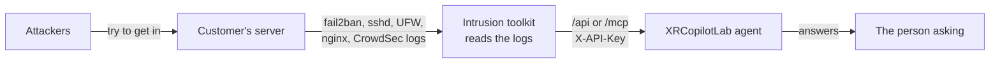
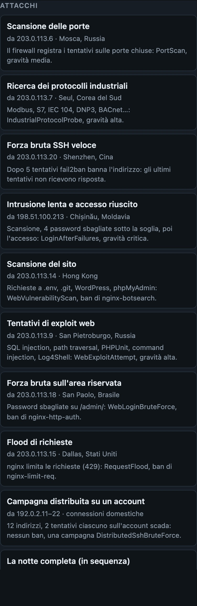
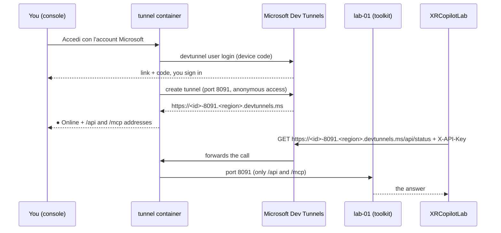

# xrcopilotlab-intrusion-mcp

**In plain words:** a small program, installed on a customer's Linux server, that tells an XRCopilotLab agent who is
trying to break into that server. The agent can then answer questions like *"Is anyone attacking us tonight?"*,
*"Where do the attacks come from?"*, *"Did anybody actually get in?"*.

It only **reads** and never changes anything. The server already has its own guards (fail2ban, the UFW firewall,
nginx, CrowdSec): they block the attackers and write what they did in their logs. This program reads those logs,
understands what kind of attack each line is, finds the city each address comes from, and answers the agent.


*The test console of the Docker lab (`make lab-up`): on the left the numbers, the XRCopilotLab connection and the
attack buttons; on the right the map of the attackers and the table of what the toolkit saw.*



## Contents

- [What it reads: the security packages](#what-it-reads-the-security-packages)
  ([what could come next](#more-guardians-what-could-come-next), [full analysis](docs/security-tools.md))
- [The test console (Docker lab)](#the-test-console-docker-lab)
- [Install the toolkit on a customer's server](#install-the-toolkit-on-a-customers-server)
- [A public test address for XRCopilotLab (dynamic URL)](#a-public-test-address-for-xrcopilotlab-dynamic-url)
- [Commands (make)](#commands-make)
- [Tools](#tools), [Attack types](#attack-types), [The simulated host](#the-simulated-host),
  [Authentication](#authentication), [Configuration](#configuration)
- [Register it in XRCopilotLab](#register-it-in-xrcopilotlab)

---

## What it reads: the security packages

The toolkit does not watch the network itself: it reads what the server's **security packages** (the "guardians")
write. Each one guards a different door; together they tell the whole story.

| Package | What it is for, in plain words | Log it writes | What the toolkit learns from it |
|---|---|---|---|
| **fail2ban** | The bouncer: after too many wrong passwords it blocks the address for a while | `/var/log/fail2ban.log` | Who was banned, when, by which rule ("jail"); repeat offenders (`recidive`) |
| **sshd** (OpenSSH) | The remote-login door of the server | `/var/log/auth.log` | Wrong passwords, accounts tried, and **who actually got in** |
| **UFW** | The firewall: closes every port that is not needed | `/var/log/ufw.log` | Knocks on closed doors: port scans, searches for industrial protocols (Modbus, S7…) |
| **nginx** | The web server | `/var/log/nginx/access.log` | What a web attacker asked for: `.env`, WordPress, SQL injection, Log4Shell… |
| **CrowdSec** | A community "neighbourhood watch": shared rules that spot attacks fail2ban misses, such as a very slow brute force | `/var/log/crowdsec.log` | Its alerts and decisions |

A detector the host does not have is simply absent from the answers.

| Mode | Where it runs | What it reads | Use |
|---|---|---|---|
| `simulated` | Our Azure Container App `hev-intrusion-mcp` | A synthetic host generated in memory | Demos (ALVEO) |
| `logs` | The customer's host, next to its detectors | The five logs above | Production |

Two faces, same key, same answers: **MCP** on `/mcp` (for whoever registers the server in XRCopilotLab by hand) and
**REST** on `/api` (for a blueprint, which provisions it as a `kind: builder` server with no manual step).

Both modes go through the same parsers and rules: the simulated host writes real-format log lines, and the server
reads them exactly as it reads a real host.

### More guardians: what could come next

We analysed other open-source security tools the toolkit could read; the full analysis, with licences, log formats,
costs and sources, is in [docs/security-tools.md](docs/security-tools.md). In short:

| Package | What it is for, in plain words | Verdict |
|---|---|---|
| **Suricata** | A network "metal detector": checks **all** traffic against thousands of known attack signatures (free ET Open rules), on every port, and sees a hacked server calling home (malware, C2). Knows Modbus, DNP3, ENIP | **Next, priority 1** (effort M) |
| **Falco** | A CCTV inside the server: notices what happens **after** a break-in (nginx starting a shell, someone reading `/etc/shadow`, writes to `/etc`) | **Priority 2** (M) |
| auditd | The Linux kernel's own register of who did what; Falco's alternative using only Ubuntu packages | Fallback for Falco (L: hard log format) |
| **ModSecurity + OWASP CRS** | A web firewall in nginx that reads the **whole** request (also POST bodies), in detection-only mode | **Priority 3** (M) |
| Apache, Postfix/Dovecot, OpenVPN, sshguard, `sudo` lines | More doors many servers have: other web server, mail, VPN, another SSH bouncer, administrator commands | Quick wins, no new software (S) |
| Zeek + CISA ICSNPP | Deep view of industrial protocols (S7, Modbus, DNP3, BACnet) | Only on a separate sensor in the **plant network**, not on a public server (L) |
| Wazuh / OSSEC | A complete security platform (SIEM) | Read it only where the customer already has it; never installed by us |
| AIDE | Notices files that changed when they should not | Later (S–M) |
| ClamAV | Antivirus for files and web shells | Later: needs about 1 GB of RAM |
| Lynis, rkhunter, chkrootkit | Hardening check, rootkit search | Low priority: posture, not attacks; many false alarms |
| Snort 3, Malcolm, GRASSMARLIN, WireGuard | — | No: rules need a commercial licence / too heavy / archived / writes no log |

**Installing the guardians.** Today the package installs only the toolkit and reads the guardians the server already
has. Next version: `sudo ./install.sh --with fail2ban,crowdsec,suricata` will also install and configure the
guardians you name, idempotently and only when asked, Suricata and ModSecurity in detection-only mode. UFW is never
switched on by the script: a firewall turned on by mistake can lock everyone out of SSH.

---

## The test console (Docker lab)

To see the toolkit at work without a customer's server, `make up` starts a small lab on your computer, all in Docker:

- **`lab-01`** (container `intrusion-lab-01`), a fake company server (Ubuntu, "Alveo Energia" in Turin) with SSH, a website, fail2ban and a firewall,
  and **the same toolkit package a customer installs**, installed by the same `install.sh`;
- **`attacker`** (container `intrusion-lab-attacker`), which attacks `lab-01` when you press a button, and serves the console on
  **http://localhost:8090**;
- **`tunnel`** (container `intrusion-lab-tunnel`), which gives `lab-01` a public HTTPS address, so XRCopilotLab can call it (see
  [below](#a-public-test-address-for-xrcopilotlab-dynamic-url)).

The attacks never leave the lab: all addresses are "documentation" addresses (RFC 5737) that no real computer uses,
and each one gets an invented city so that the map has something to show. Everything the console shows comes from the
toolkit on `lab-01`, exactly as XRCopilotLab would receive it.

### The numbers


| Number | What it means |
|---|---|
| **tentativi** | Attempts in the period: wrong passwords, suspicious web requests, … |
| **indirizzi** | How many different addresses attacked |
| **bannati ora** | Addresses blocked right now by fail2ban |
| **blocchi firewall** | Connections the firewall refused on closed ports |

Under the numbers, a red box appears when something serious happens: for example *"Accesso sospetto: operatore è
entrato da 198.51.100.213 dopo 4 tentativi falliti"*, someone who got in after guessing the password.

### The attacks



Each card is a real attack, run against `lab-01` when you click it; the box *"Cosa sta facendo l'attaccante"* shows,
line by line, the commands the attacker runs (nmap, ssh, curl…) and what happens.

| Attack | From | What the toolkit should see |
|---|---|---|
| Scansione delle porte | 203.0.113.6 (Moscow) | Port scan, medium |
| Ricerca dei protocolli industriali | 203.0.113.7 (Seoul) | Probe of Modbus, S7, IEC 104, DNP3, BACnet… high |
| Forza bruta SSH veloce | 203.0.113.20 (Shenzhen) | SSH brute force, banned by fail2ban after 5 tries |
| Intrusione lenta e accesso riuscito | 198.51.100.213 (Chișinău) | Scan, slow password guessing under fail2ban's limit, then **a login**: critical |
| Scansione del sito | 203.0.113.14 (Hong Kong) | Requests for `.env`, `.git`, WordPress, phpMyAdmin: banned |
| Tentativi di exploit web | 203.0.113.9 (Saint Petersburg) | SQL injection, path traversal, Log4Shell…: high |
| Forza bruta sull'area riservata | 203.0.113.18 (São Paulo) | Wrong passwords on `/admin/`: banned |
| Flood di richieste | 203.0.113.15 (Dallas) | Too many requests (429): banned |
| Campagna distribuita su un account | 192.0.2.11–22 (12 cities) | 12 addresses, 2 tries each on one account: no ban, but a campaign |
| La notte completa | all of them | All the above in sequence, about three minutes: the best demo |

### The map


The blue square is `lab-01` (Turin). Every dot is an attacking address, placed on its city; the dashed line goes from
the attacker to the server. The colour is the severity: **red** critical, **orange** high, **yellow** medium. The map
is OpenStreetMap: drag and zoom it as any online map.

### The table


One row per attacking address, most serious first:

| Column | What it means |
|---|---|
| **Gravità** | `critica` (someone got in), `alta`, `media`, `bassa` |
| **Indirizzo / Città** | Who attacked, and from where |
| **Tipo di attacco** | What they tried, in words (SSH brute force, site scan, web exploit, …) |
| **Tentativi** | How many tries |
| **Blocchi** | How many connections the firewall refused |
| **Bannato** | `sì` if fail2ban is blocking that address now |
| **Ultimo evento** | When it last did something |

**Periodo** changes the window: last hour, last 24 hours, last week. The page refreshes by itself.

---

## Install the toolkit on a customer's server

What the customer gets is **one file**, a `.tar.gz` package with everything inside: the program (a single file, no
.NET to install), the systemd service and the install script.

### 1. Get the package

Download it from the release page, **https://github.com/hevolusinnovation/xrcopilotlab-intrusion-mcp/releases/latest**
(the repository is private: you need a Hevolus GitHub account). There are two packages; pick the one for the server's
processor (`uname -m` on the server: `x86_64` → x64, `aarch64` → arm64):

| File | Server |
|---|---|
| `xrcopilotlab-intrusion-mcp-<version>-linux-x64.tar.gz` | Intel/AMD (most servers and cloud VMs) |
| `xrcopilotlab-intrusion-mcp-<version>-linux-arm64.tar.gz` | ARM (Azure Ampere, AWS Graviton, Raspberry Pi 64-bit) |
| `SHA256SUMS` | Fingerprints, to check the download: `sha256sum -c SHA256SUMS --ignore-missing` |

From the command line, and straight to the server:

```bash
gh release download v0.1.0 -R hevolusinnovation/xrcopilotlab-intrusion-mcp -p '*linux-x64.tar.gz' -p SHA256SUMS
scp xrcopilotlab-intrusion-mcp-0.1.0-linux-x64.tar.gz SHA256SUMS admin@<server>:/tmp/
```

Or build it from this repository: `make package VERSION=0.1.0` (add `RID=linux-arm64` for ARM); the file lands in
`out/`.

### 2. Install it

On the server (Debian or Ubuntu, with fail2ban already running):

```bash
cd /tmp
sha256sum -c SHA256SUMS --ignore-missing
tar -xzf xrcopilotlab-intrusion-mcp-0.1.0-linux-x64.tar.gz
cd xrcopilotlab-intrusion-mcp-0.1.0-linux-x64
sudo ./install.sh
```

The script asks for the **key** XRCopilotLab will send (at least 24 characters; it can also come from
`INTRUSION_MCP_API_KEY`). It keeps only the key's fingerprint (SHA-256), never the key itself. Then it:

- checks that the package is for this server's processor, before touching anything;
- installs `libicu` if missing (the only system library it needs);
- copies the program to `/opt/xrcopilotlab-intrusion-mcp/`, the key's fingerprint to `/etc/xrcopilotlab-intrusion-mcp/env`;
- creates the user `xrcopilot-intrusion`, who can read `/var/log` and nothing else (read-only system);
- starts the service `xrcopilotlab-intrusion-mcp` and waits until it answers.

**Run it again whenever you like: it is idempotent.** A second run, or a newer version, gives the same result as a first
install and never asks twice:

| On a second run | What happens |
|---|---|
| The key | **kept**; `sudo ./install.sh --new-key` replaces it (the old one stops working) |
| `appsettings.Production.json` | **kept** if you changed it; the new defaults go next to it as `appsettings.Production.json.new` |
| The DB-IP file in `geo/` | kept |
| The program and the service | replaced, then the service restarts with the new version (`upgrading 0.1.0 -> 0.2.0`) |
| User, folders, `libicu` | created only if missing |

Options: `--new-key` (replace the key), `--no-start` (install without starting, for images built ahead).

### 3. Where it answers

| Address | Who uses it |
|---|---|
| `http://127.0.0.1:8080` | The toolkit itself, **only from inside the server**: nobody outside can reach it |
| `https://<server>/intrusion-mcp/api` | XRCopilotLab, from a blueprint (connection with HTTP tools) |
| `https://<server>/intrusion-mcp/mcp` | XRCopilotLab, as an MCP server registered by hand |

The two public addresses go through the nginx already on the server, with its HTTPS certificate. The install script
prints the block to add, which also lets in only XRCopilotLab's addresses:

```nginx
location /intrusion-mcp/ {
    allow <XRCopilotLab address>;
    deny  all;
    proxy_pass http://127.0.0.1:8080/;
    proxy_http_version 1.1;
    proxy_buffering off;
}
```

### 4. Check it

```bash
curl -s http://127.0.0.1:8080/healthz                                      # on the server
curl -s https://<server>/intrusion-mcp/api/status -H "X-API-Key: <key>"     # from outside
systemctl status xrcopilotlab-intrusion-mcp                                 # the service
journalctl -u xrcopilotlab-intrusion-mcp -f                                 # its log
```

**Cities on the map (optional):** download the free DB-IP "IP to City Lite" file (https://db-ip.com/db/lite.php),
save it as `/opt/xrcopilotlab-intrusion-mcp/geo/dbip-city-lite.csv.gz` and run
`sudo systemctl restart xrcopilotlab-intrusion-mcp`. Without it everything works, but without places.

Tried in the Docker lab (first install and repeated runs), not yet on a customer's server. Two things to check there: that `/var/log/crowdsec.log` is
readable by the group `adm`, and the exact line format of the server's CrowdSec version.

---

## A public test address for XRCopilotLab (dynamic URL)

The lab runs on your laptop, but XRCopilotLab runs in the cloud: it needs a public address to reach `lab-01`. The
`tunnel` container creates one with **Microsoft Dev Tunnels**, free, and you do everything from the console: nothing to
install on the Mac.


*Addresses and account in this picture are examples.*

### How the address is created

1. In the console, box **Collegamento a XRCopilotLab**, click **Accedi con l'account Microsoft**.
2. The console shows a Microsoft link (`https://microsoft.com/devicelogin`) and a **code**: open the link, enter the
   code and sign in with your Hevolus (Entra ID), Microsoft or GitHub account.
3. The console notices the login by itself; the `tunnel` container creates a tunnel and opens it. After a few seconds
   the box says **● Online** and shows the addresses.
4. Copy the addresses and the key with the **Copia** buttons, and paste them in XRCopilotLab.
5. **Verifica dall'indirizzo pubblico** calls `lab-01` through the public address, as XRCopilotLab will: if it says
   ok, the connection works.



### What the address looks like

```
https://<id>-8091.<region>.devtunnels.ms/api    connection with HTTP tools (blueprint)
https://<id>-8091.<region>.devtunnels.ms/mcp    MCP server registered by hand
X-API-Key: <the lab key>                        header, from "Copia la chiave"
```

`<id>` is the tunnel's name, chosen by Microsoft; `8091` is `lab-01`'s port; `<region>` is the closest Microsoft region
(for example `eun1`, North Europe).

### How long it lasts

| Action | The address |
|---|---|
| `make down`, then `make up` | **stays the same**: login and tunnel are kept (Docker volume `tunnel-login`) |
| Unused for 30 days | expires: the next start creates a new one |
| **Esci** in the console | closes the tunnel; signing in again with the same account gives back the same address, with another account a new one |
| `make lab-reset` | is forgotten: the next login creates a new address |

### Is it safe?

- The tunnel reaches **only** `/api` and `/mcp` of the toolkit on `lab-01`: not SSH, not the website, not the console.
- The tunnel has anonymous access (XRCopilotLab cannot sign in to Microsoft), but **every call still needs the key**.
- The key is in `lab/.env` (never committed); the browser never sees it unless you press *Copia la chiave*.
- Dev Tunnels is for development and tests (limits: 5 GB of traffic and 10 tunnels per user per month). **Never use
  it for a customer's server**: there, the toolkit is published by the customer's nginx, as described above.

---

## Commands (make)

`make help` prints them all.

| Command | What it does |
|---|---|
| `make up` | Builds and starts the lab; console on http://localhost:8090 (creates `lab/.env` with the lab key the first time) |
| `make down` | Stops the lab; keeps the tunnel login (same public address next time) |
| `make lab-build` | Builds the lab images without starting them |
| `make lab-restart` | Stops and starts again, rebuilding what changed |
| `make lab-rebuild` | Rebuilds the images from scratch and restarts |
| `make lab-ps` | Which containers are running, and whether they are healthy |
| `make lab-logs` | Follows the logs; `SVC=lab-01`, `attacker` or `tunnel` for one container |
| `make lab-shell` | Opens a shell in `lab-01` (or `SVC=…`); same as `docker exec -it intrusion-lab-01 bash` |
| `make lab-open` | Opens the console in the browser |
| `make lab-reset` | Stops the lab and deletes everything, tunnel login included |
| `make build` / `make test` | Builds the solution / runs the unit tests |
| `make run` | The toolkit on your Mac, simulated mode, on http://localhost:5290 (needs `INTRUSION_MCP_API_KEY`) |
| `make package VERSION=…` | The package for a customer's server, in `out/` |
| `make docker-build` / `docker-push` / `deploy` / `smoke` `TAG=…` | The demo on Azure (simulated mode) |
| `make key` | Prints the SHA-256 of a key typed in the terminal |

More on the lab (how the firewall logs are produced, what the lab found in the package): [lab/README.md](lab/README.md).

---

## Tools

All tools are read-only (`readOnlyHint: true`). Every answer carries `simulated` and the geolocation attribution.
The period is the last 24 hours by default (`hours`, max 720), or `since`/`until` in ISO 8601.

| Tool | Answers |
|---|---|
| `intrusion_status` | Active jails, addresses banned now per jail, bans and attempts in the last 24 h, latest event. |
| `intrusion_banned_ips` | Addresses banned now: jail, attack type, since when, location. Filter by `jail`. |
| `intrusion_attempts` | One row per source address, most serious first: attempts, bans, accounts tried, attack types, severity, location. Filters: `jail`, `attackType`, `country`, `top`. |
| `intrusion_ip_detail` | Everything one address did: summary, suspicious logins, timeline (up to 200 events). |
| `intrusion_suspicious_logins` | Successful SSH logins after repeated failures (Critical) or from an unexpected country (High). |
| `intrusion_summary` | Totals, by attack type, by country, most targeted closed ports, top attackers, distributed campaigns, suspicious logins, map points (lat/lon/severity) for a map. |

REST, same parameters as query strings: `GET /api/status`, `/api/banned?jail=`, `/api/attempts?hours=&jail=&attackType=&country=&top=`,
`/api/ips/{ip}?hours=`, `/api/suspicious-logins?hours=`, `/api/summary?hours=&top=`.

### Attack types

| Type | From |
|---|---|
| `SshBruteForce` | sshd failures from one address (3 or more, or an sshd ban) |
| `DistributedSshBruteForce` | One account tried by 8+ addresses, each with 4 failures at most, trying nothing else: fail2ban alone never bans them |
| `WebLoginBruteForce` | Jails `nginx-http-auth`, `apache-auth`, `wordpress`, …; nginx 401; CrowdSec `http-*-bf` |
| `WebVulnerabilityScan` | Jails `nginx-botsearch`, …; nginx requests for `/.env`, `/.git/`, WordPress, phpMyAdmin, admin consoles, backups, web shells, `cgi-bin`, scanner user agents; CrowdSec `http-probing`, `http-sensitive-files`, … |
| `WebExploitAttempt` | nginx requests with SQL injection, path traversal, command injection, Log4Shell, PHPUnit RCE; CrowdSec `*-cve-*`, `http-sqli-probing`, … |
| `RequestFlood` | Jails `nginx-limit-req`, `apache-modsecurity`; nginx 429 |
| `MailLoginBruteForce` | Jails `postfix-sasl`, `dovecot`, … |
| `PortScan` | 10+ distinct closed ports from one address (UFW); CrowdSec `iptables-scan-multi_ports` |
| `IndustrialProtocolProbe` | Any connection to Modbus 502, S7 102, IEC 104 2404, DNP3 20000, EtherNet/IP 44818, OPC UA 4840, BACnet 47808, Niagara Fox 1911 |
| `RepeatOffender` | Banned by the `recidive` jail |
| `LoginAfterFailures` | An `Accepted …` login after 3+ failures from the same address in the previous 24 h: possible compromise |

Severity: `Critical` (login after failures), `High` (repeat offender, industrial probe, web exploit, login from an
unexpected country), `Medium` (any ban, a CrowdSec alert, 10+ attempts, campaign, flood, web login brute force, port
scan), `Low` (the rest). A user who mistypes once and then logs in is not reported, nor are ordinary web visitors or
a few stray packets on the firewall.

One attempt is counted once: sshd failures from `auth.log` (fail2ban's `Found` only when `auth.log` is missing), web
requests from whichever of fail2ban and nginx saw more. Firewall blocks and CrowdSec alerts are reported apart.

---

## The simulated host

`bastion-01`, an SSH and nginx host in Europe/Rome behind UFW, protected by fail2ban with `sshd` (5 tries in 10 min,
1 h ban), `nginx-http-auth`, `nginx-botsearch`, `nginx-limit-req` and `recidive` (3 bans in a day, 1 week), with
**CrowdSec in detection mode** (it alerts and decides, but no bouncer enforces). Each day it has:

- SSH brute force from 25-45 addresses, most of them banned; web vulnerability scans; web login brute force; web
  exploit attempts (SQL injection, path traversal, Log4Shell, PHPUnit, command injection);
- every fourth day, a request flood;
- firewall noise on closed ports (Telnet, RDP, SMB…), 2-4 port scans, and one probe of the industrial control ports;
- a **distributed campaign** on one account (`admin`, `scada`, `engineer`, `vpn` in rotation) from 14-25 home
  connections, none banned;
- one address banned three times, then by `recidive` for a week;
- **the intrusion**, from `198.51.100.213` (Chișinău): at 00:31 a port scan; from 00:52 one SSH try every 160-230 s on
  `operatore`, slow enough that fail2ban never bans it; around 01:25 CrowdSec raises `ssh-slow-bf`, which nothing
  enforces; around 02:50 a successful password login. The agent sees the whole sequence, and could have acted at
  00:31 or at 01:25;
- legitimate logins: the nightly `backup` key from the office (03:00), the `deploy` key in working hours, the
  administrator `m.ferri` who mistypes once at 09:xx; ordinary web visitors and a crawler.

Deterministic: the same seed and day give the same lines on every replica and after every restart. Today is cut at
the current time, so new attacks appear during the day. Settings: `Simulation:Hostname`, `Seed`, `Days` (30),
`TimeZone`, `IncidentEveryDays` (1).

**All data is synthetic.** Every address is in a documentation range (RFC 5737: `192.0.2.0/24`, `198.51.100.0/24`,
`203.0.113.0/24`), which no real host uses, with an invented city; networks carry documentation AS numbers
(RFC 5398). A test fails if a simulated address is anything else.

---

## Authentication

XRCopilotLab sends the key in the `X-API-Key` header. The server stores only its SHA-256 (`ApiKeys:Hash`, hex
lowercase); a second key for a rotation goes in `ApiKeys:Keys:n:Hash`. The key is accepted in the header only, never
in the query string, so it never ends up in the MCP server's address. `/healthz` answers 503 while no key is
configured; `/livez` answers when the process is up. 120 calls per minute per key.

---

## Configuration

| Key | Default | Meaning |
|---|---|---|
| `Server:Mode` | `logs` | `logs` or `simulated` |
| `ApiKeys:Hash` | — | SHA-256 of the key |
| `Logs:Fail2banFiles` | `/var/log/fail2ban.log*` | fail2ban logs; `*` takes the rotated copies, `.gz` included |
| `Logs:AuthFiles` | `/var/log/auth.log*` | sshd logs (`/var/log/secure*` on RHEL) |
| `Logs:FirewallFiles` | `/var/log/ufw.log*` | UFW logs (`ufw logging low` or higher) |
| `Logs:WebAccessFiles` | `/var/log/nginx/access.log*` | nginx access logs, `combined` format |
| `Logs:CrowdsecFiles` | `/var/log/crowdsec.log*` | CrowdSec logs |
| `Logs:TimeZone` | system zone | IANA id; fail2ban writes local time |
| `Logs:MaxDays` | 30 | how far back to read |
| `Geo:DbIpCityLiteCsv` | — | DB-IP "IP to City Lite" CSV (`.csv` or `.csv.gz`); without it, no geolocation in the `logs` mode |
| `Policy:AllowedCountries` | `["IT"]` | countries a login is expected from |
| `Policy:FailuresBeforeLogin` | 3 | failures before a login that make it suspicious |
| `Policy:CampaignMinIps` / `CampaignMaxPerIp` | 8 / 4 | distributed campaign thresholds |
| `Policy:PortScanMinPorts` | 10 | distinct closed ports that make a port scan |

Geolocation in the `logs` mode uses **DB-IP Lite** (https://db-ip.com/db/lite.php, CC BY 4.0: commercial use allowed,
attribution returned in every answer). The file is not in the repository: download it on the host. The DB-IP CSV
column order (`ip_start,ip_end,continent,country,stateprov,city,latitude,longitude`) is the one documented by DB-IP
and has not yet been checked against a downloaded file.

---

## Build, test, run locally

```bash
make test
export INTRUSION_MCP_API_KEY=...   # any local key, never committed
make run                           # simulated mode on http://localhost:5290
curl -s http://localhost:5290/mcp -H "X-API-Key: $INTRUSION_MCP_API_KEY" \
  -H 'Content-Type: application/json' -H 'Accept: application/json, text/event-stream' \
  -d '{"jsonrpc":"2.0","id":1,"method":"tools/call","params":{"name":"intrusion_summary","arguments":{}}}'
```

## Deploy the demo (simulated mode)

```bash
az acr login -n crhevoluscoi
make docker-push TAG=0.1.0
export INTRUSION_MCP_API_KEY=$(az keyvault secret show --vault-name <vault> -n intrusion-mcp-apikey --query value -o tsv)
make deploy TAG=0.1.0
make smoke
```

Container App `hev-intrusion-mcp` on `hev-coi-mcp-env`, `minReplicas: 0` with the HTTP scale rule. The key's hash is
a Container App secret; the clear key stays in Key Vault and is the value to register in XRCopilotLab.

## Register it in XRCopilotLab

Which address to use: `https://<server>/intrusion-mcp` on a customer's server, `https://<id>-8091.<region>.devtunnels.ms`
for the lab, the Container App's address for the demo. Below it is `<base>`.

- **From a blueprint** (no manual step): a `webhook` connection with `baseUrl: <base>/api`, `CustomHeaders`
  `X-API-Key` from a secret of the tag, and an `mcpServers` entry `kind: builder` with one GET tool per route.
- **By hand**: Administration › MCP, a new server with address `<base>/mcp` and the key in a `X-API-Key`
  header (custom headers), then assign it to the agent; a blueprint then cites it as `kind: existing`.

---

## Repository layout

```
src/XrCopilotLab.Intrusion.Mcp.Core/     pure logic, no I/O
  Parsing/      fail2ban, auth.log, ufw.log, nginx access.log, crowdsec.log parsers; web attack patterns
  Analysis/     attack catalogue, threat analyzer, policy
  Geo/          reserved ranges, range table (DB-IP), locator interface
  Simulation/   synthetic host and its invented geography
  Sources/      log source interface, simulated source
  Queries/      the answers behind the tools
src/XrCopilotLab.Intrusion.Mcp.Server/   ASP.NET host: MCP tools, REST face, API key, file source, DB-IP loader
tests/                                   parsers, analyzer, geo, the simulated story
deploy/linux/                            systemd unit, install script, production settings
infra/                                   Container App of the demo
```

## Out of scope for now

- Writing actions (ban, unban, whitelist): possible later, always with a person's confirmation.
- Suricata, Falco, ModSecurity and the other guardians: analysed in [docs/security-tools.md](docs/security-tools.md), Suricata first.
- Windows hosts (Event Log), Apache access logs, nginx in a custom log format.
- Reputation data (AbuseIPDB, CrowdSec CTI): commercial plans needed.
