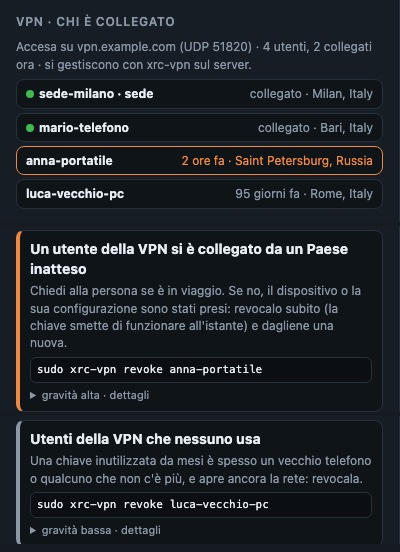

# La VPN dell'azienda: guida per chi la gestisce

Questa guida è per la persona che, in azienda, decide chi può entrare nella rete da fuori: il titolare, il referente
informatico o il fornitore di fiducia. Non serve essere esperti di reti: bastano un accesso al server e i comandi
riportati qui.

**Gli utenti della VPN li crea e li toglie sempre l'azienda.** Hevolus installa lo strumento ma non crea utenti e non
gestisce la configurazione del vostro server: chi entra nella vostra rete lo decidete voi.

## A cosa serve

La VPN è un **ingresso riservato** alla rete dell'azienda. Un dipendente in trasferta, da casa o dal cliente, accende
la VPN sul telefono o sul portatile e lavora come se fosse in ufficio: raggiunge il gestionale, le cartelle condivise,
il desktop remoto, le macchine dell'impianto. Lo stesso vale per una **seconda sede**: il suo router si collega alla
VPN e le due reti si vedono.

Così i servizi delicati (desktop remoto, cartelle condivise, Modbus e gli altri protocolli industriali) non devono più
essere aperti su internet, dove chiunque li può attaccare. La pagina di monitoraggio, alla voce *Cosa migliorare*, vi
segnala quelli ancora aperti.

Ogni dispositivo ha **la sua chiave**. Chi non ha una chiave valida non riceve nessuna risposta: per lui la porta della
VPN sembra chiusa come tutte le altre.

## Prima di iniziare

1. **Un indirizzo pubblico dell'ufficio**: l'IP pubblico della linea internet o un nome (`vpn.azienda.it`). Lo trovate
   nel contratto con il provider o nella pagina del router.
2. **Una regola sul router dell'ufficio**: inoltrare la porta **UDP 51820** verso il server su cui è installata la VPN
   (la voce si chiama di solito *port forwarding*, *virtual server* o *NAT*).
3. **Attenzione alle linee senza IP pubblico.** Alcune linee in fibra e quasi tutte quelle mobili (4G/5G) condividono
   l'IP pubblico con altri clienti (si chiama *CGNAT*): da fuori non si può entrare. Le soluzioni sono chiedere al
   provider un **IP pubblico** (spesso costa pochi euro al mese) oppure usare l'**IPv6** della linea, se c'è: la VPN lo
   supporta (vedi più avanti).

## Installazione (una volta sola)

La fa chi amministra il server, insieme al pacchetto di monitoraggio:

```bash
sudo VPN_ENDPOINT=vpn.azienda.it ./install.sh --with wireguard
```

Alla fine l'installazione scrive **quale rete interna apre la VPN**, cioè quella che ha trovato da sola. Controllatela:
se il server ha più schede di rete, potrebbe aver scelto quella sbagliata. Per cambiarla:

```bash
xrc-vpn lan 192.168.1.0/24
```

Se l'indirizzo pubblico non lo sapete ancora, potete impostarlo dopo con `xrc-vpn endpoint`.

## Chi può gestire gli utenti

Chi gestisce la VPN non ha bisogno di essere amministratore completo del server: basta aggiungere il suo account al
gruppo **vpn-admin**. Da quel momento può usare il comando `xrc-vpn`, e solo quello, con la propria password.

```bash
sudo usermod -aG vpn-admin anna        # poi Anna esce e rientra nel server
```

## Aggiungere un telefono o un portatile

```bash
xrc-vpn add mario-telefono
```

Il server mostra un **QR code**. Sul telefono di Mario:

1. installate l'app ufficiale **WireGuard** (App Store o Google Play);
2. toccate **+** e poi **Scansiona da codice QR**;
3. date un nome alla connessione e accendetela.

Per un portatile (Windows, Mac, Linux) è più comodo un file da importare:

```bash
xrc-vpn add mario-pc --conf > mario-pc.conf
```

Nell'app WireGuard del portatile scegliete **Importa tunnel da file**, poi **cancellate il file**: contiene la chiave
di Mario.

> Il QR e il file si vedono **una volta sola**: il server non conserva la chiave privata del dispositivo. Consegnateli
> di persona, mai via email o chat. Se si perdono, `xrc-vpn reissue mario-telefono` ne crea di nuovi e quelli vecchi
> smettono di funzionare.

Usate nomi che dicano **di chi è** e **quale dispositivo** (`mario-telefono`, `mario-pc`): quando qualcosa non va,
sapete subito a chi chiedere. Il nome può contenere solo lettere minuscole, numeri e trattini.

## Aggiungere il router di un'altra sede (o un PC gestito dall'IT)

Un router crea **da solo** la sua chiave e vi fornisce solo la **chiave pubblica**, che non è segreta. La chiave
privata non lascia mai il router. Nel menu WireGuard del router (FRITZ!Box, MikroTik, pfSense/OPNsense, Draytek…)
create una nuova connessione, copiate la chiave pubblica che vi mostra e date:

```bash
xrc-vpn add sede-milano --pubkey <chiave pubblica del router> --lan 192.168.20.0/24
```

`--lan` è la rete della sede di Milano, e deve essere **diversa** da quella dell'ufficio principale. Il server stampa i
campi da copiare nel router: indirizzo del tunnel, chiave pubblica del server, endpoint, reti consentite, *preshared
key* e *keepalive*. La *preshared key* è segreta: copiatela nel router e non conservatela altrove.

Allo stesso modo un PC gestito dal vostro reparto IT può creare la chiave nell'app (*Aggiungi tunnel vuoto*) e dare
solo la chiave pubblica con `--pubkey`, senza `--lan`.

Perché i computer dell'ufficio principale raggiungano quelli di Milano, il router dell'ufficio deve sapere che la rete
`192.168.20.0/24` passa dal server della VPN (una *rotta statica*). Da Milano verso l'ufficio invece funziona subito.

## Togliere un utente

```bash
xrc-vpn revoke mario-telefono
```

L'effetto è **immediato**: la chiave non apre più niente. Fatelo subito quando:

- un dispositivo viene perso o rubato;
- una persona lascia l'azienda o cambia ruolo;
- la pagina di monitoraggio segnala un collegamento da un **Paese inatteso** e la persona non è in viaggio.

## Vedere chi è collegato

```bash
xrc-vpn list
```

```
NAME                     KIND    ADDRESS         LAST CONNECTION
mario-telefono           device  10.88.0.2       3 min ago
sede-milano              router  10.88.0.3       0 min ago
luca-vecchio-pc          device  10.88.0.5       never
```

La **pagina di monitoraggio** mostra gli stessi utenti, con la città da cui si sono collegati.



*Un esempio con dati simulati: anna-portatile si è collegata da un Paese inatteso, luca-vecchio-pc non si collega da
mesi; per ciascuno la pagina propone il comando che lo revoca.*
 Alla voce *Cosa
migliorare* trovate:

- **un utente collegato da un Paese inatteso** (gravità alta), con il comando per revocarlo già pronto;
- **utenti che nessuno usa** da più di 60 giorni: spesso un vecchio telefono o qualcuno che non c'è più, e la loro
  chiave apre ancora la rete;
- **la VPN senza indirizzo pubblico**, se manca `xrc-vpn endpoint`.

L'assistente XRCopilotLab legge le stesse informazioni e può proporvi una revoca, ma non la fa: la decisione resta
vostra.

## Cambiare l'indirizzo pubblico o la rete interna

Se cambia l'IP o il nome dell'ufficio:

```bash
xrc-vpn endpoint 93.41.10.7
```

Se cambia la rete interna da raggiungere (anche più reti, separate da virgola):

```bash
xrc-vpn lan 192.168.1.0/24,192.168.5.0/24
```

In entrambi i casi gli utenti già creati hanno ancora i dati vecchi nella loro configurazione: il comando ve li elenca.
Per ciascuno:

```bash
xrc-vpn reissue mario-telefono
```

Un telefono o un portatile riceve un nuovo QR (o file, con `--conf`), con una chiave nuova. Un router tiene la sua
chiave: `reissue` ristampa i campi da ricopiare nel router.

## IPv6

La VPN funziona anche in IPv6:

- **come indirizzo pubblico**: se la linea dell'ufficio ha IPv6, potete dare quell'indirizzo
  (`xrc-vpn endpoint 2001:db8::7`). È la via d'uscita più comune quando la linea non ha un IPv4 pubblico (CGNAT).
  Il router deve lasciar passare la porta UDP 51820 verso il server anche in IPv6. Il telefono che si collega deve
  avere IPv6 a sua volta: oggi quasi tutte le reti mobili italiane lo hanno;
- **dentro il tunnel**: ogni utente riceve anche un indirizzo IPv6 privato, creato alla prima accensione e diverso per
  ogni azienda;
- **verso la rete interna**: se l'ufficio usa IPv6, `xrc-vpn lan` accetta anche reti IPv6
  (`xrc-vpn lan 192.168.1.0/24,2001:db8:1::/64`).

## Cosa fa e cosa non fa

- Apre **solo** le reti interne indicate. Non fa uscire su internet attraverso l'ufficio: ognuno naviga con la propria
  connessione.
- Non tocca il firewall UFW del server. Se è acceso, l'installazione vi dice la regola da aggiungere
  (`sudo ufw allow 51820/udp`).
- Non registra tentativi falliti: chi non ha la chiave giusta non riceve risposta, e non c'è niente da registrare.
- Non sostituisce le password dei servizi: chi entra in VPN deve comunque accedere al gestionale, alle cartelle e agli
  altri servizi con le proprie credenziali.

## Quando qualcosa non va

| Problema | Cosa controllare |
|---|---|
| L'app non si collega mai (nessun "handshake") | La regola di port forwarding UDP 51820 sul router; l'indirizzo pubblico (`xrc-vpn show`); se la linea è in CGNAT (vedi sopra); che il telefono non sia su una rete Wi-Fi che blocca le VPN |
| Si collega ma non raggiunge i computer dell'ufficio | La rete interna aperta (`xrc-vpn show`, riga *Internal network*); se è sbagliata, `xrc-vpn lan` e poi `reissue` per gli utenti |
| Funzionava e ora no | L'IP pubblico dell'ufficio è cambiato: `xrc-vpn endpoint`, poi `reissue`; oppure l'utente è stato revocato |
| Un utente compare da una città strana | Chiedete alla persona; se non è lei, `xrc-vpn revoke <nome>` subito |

## Riepilogo dei comandi

| Comando | Cosa fa |
|---|---|
| `xrc-vpn add <nome>` | Nuovo telefono o portatile: QR code |
| `xrc-vpn add <nome> --conf > file.conf` | Lo stesso, come file da importare |
| `xrc-vpn add <nome> --pubkey <chiave> [--lan <rete>]` | Router di un'altra sede o PC con chiave propria |
| `xrc-vpn revoke <nome>` | Toglie subito l'accesso |
| `xrc-vpn reissue <nome> [--conf]` | Nuova configurazione dopo un cambio di indirizzo o di rete, o per un dispositivo perso |
| `xrc-vpn list` | Utenti e ultimo collegamento |
| `xrc-vpn show [<nome>]` | Impostazioni del server, o i campi di un router |
| `xrc-vpn endpoint <IP o nome>` | Indirizzo pubblico a cui si collegano gli utenti |
| `xrc-vpn lan <reti> \| auto` | Reti interne che la VPN apre |
