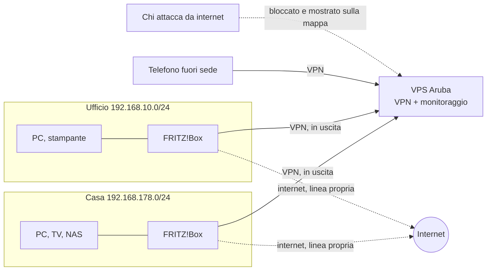

# Un VPS Aruba come server centrale per casa e ufficio

Questa guida porta, passo per passo, da un VPS appena comprato su Aruba Cloud a due sedi (casa e ufficio, ciascuna con
un FRITZ!Box) collegate tra loro in VPN, con il server di monitoraggio acceso. Il VPS è il **primo server di ingresso**:
i router delle sedi lo chiamano, lui le mette in contatto e intanto controlla chi bussa da internet.

Che cosa fa la VPN e come si gestiscono gli utenti è spiegato nella [guida alla VPN](guida-vpn.md); qui ci sono solo i
passi per il VPS, con i costi.



**I passi in breve:**

1. comprare il VPS;
2. mettere in sicurezza il primo accesso;
3. aprire solo le porte che servono;
4. installare il pacchetto;
5. cambiare la rete dell'ufficio;
6. creare le sedi;
7. configurare i FRITZ!Box;
8. verificare;
9. aggiungere il telefono.

Tempo: circa un'ora, più l'attesa per l'attivazione del VPS.

## Quanto costa

Prezzi letti su [arubacloud.com/vps](https://www.arubacloud.com/vps/) il **14 novembre 2026**, **IVA esclusa**.
Il prezzo in promozione vale per i **primi 3 mesi**, per le attivazioni fino al 12 gennaio 2027; poi si paga il prezzo
di listino. Controllateli al momento dell'acquisto.

| Piano | vCPU | RAM | Disco | Traffico/mese | Primi 3 mesi | Poi, al mese | Va bene per |
|---|---|---|---|---|---|---|---|
| VPS H.1-1 | 1 | 1 GB | 20 GB SSD | 2 TB | 2,99 € | non indicato | troppo piccolo: no |
| VPS H.1-2 | 1 | 2 GB | 40 GB SSD | 5 TB | 3,99 € | non indicato | solo VPN, fail2ban e CrowdSec, senza Suricata |
| **VPS H.2-4** | **2** | **4 GB** | **40 GB SSD** | **25 TB** | **3,00 €** | **5,49 €** | **consigliato: tutto, Suricata compreso** |
| VPS H.4-8 | 4 | 8 GB | 80 GB SSD | 50 TB | 5,00 € | 10,49 € | se il VPS ospita anche altro (sito, gestionale) |
| Cloud VPS O2A4 (OpenStack) | 2 | 4 GB | 40 GB NVMe | 25 TB | — | 6,29 € | alternativa all'H.2-4, se a quel piano Falco manca (passo 2) |

Il piano consigliato, **VPS H.2-4**, costa **meno dell'H.1-2** pur avendo il doppio delle risorse. Ha 2 vCPU e 4 GB di
RAM: bastano per la VPN, il monitoraggio, fail2ban, CrowdSec, Falco e Suricata, che da solo chiede circa 1,5 GB. I
25 TB di traffico sono molto più di quanto due sedi si scambiano anche con copie notturne di file.

**Quanto si spende in un anno, con il VPS H.2-4:**

| | IVA esclusa | IVA 22% inclusa |
|---|---|---|
| Primo anno (3 mesi a 3,00 € + 9 mesi a 5,49 €) | 58,41 € | 71,26 € |
| Dal secondo anno (12 mesi a 5,49 €) | 65,88 € | 80,37 € |
| Al mese, a regime | 5,49 € | 6,70 € |

**Cosa non costa niente:**

- WireGuard sui FRITZ!Box, che è compreso in FRITZ!OS 7.50 e successivi (l'aggiornamento è gratuito);
- l'app WireGuard per telefono e PC;
- il pacchetto di monitoraggio con tutti i suoi componenti (fail2ban, CrowdSec, Suricata, Falco, WireGuard), che sono
  software libero.

**Facoltativo:**

- un **nome a dominio** (per esempio `vpn.miaazienda.it`), solo se volete un nome al posto dell'IP del VPS o se
  XRCopilotLab deve raggiungere il server da internet (passo 10);
- le **snapshot** e i **backup** del VPS offerti da Aruba, con il loro prezzo nel pannello. Non sono indispensabili: la
  configurazione da salvare è piccola (vedi passo 11).

## 1. Comprare il VPS

Sul sito di Aruba Cloud, *VPS* › **VPS H.2-4** › *Configura*:

- **sistema operativo**: Linux, modello **Ubuntu Server 24.04 LTS** (64 bit);
- **accesso**: aggiungete la vostra **chiave SSH** se il pannello lo permette (*Aggiungi chiave SSH*). Se non ne avete
  una, sul vostro computer:
  ```bash
  ssh-keygen -t ed25519 -C "vps-aruba"      # premete Invio alle domande, mettete una passphrase
  cat ~/.ssh/id_ed25519.pub                 # questa riga va incollata nel pannello
  ```
  Senza chiave, Aruba vi manda la password di `root` per email: la cambierete al passo 2;
- **nome del server**: per esempio `vps-sedi`.

A VPS attivo, il pannello mostra il suo **indirizzo IP pubblico** (da qui in avanti: `IP_VPS`). Annotatelo.

## 2. Primo accesso e messa in sicurezza

Dal vostro computer:

```bash
ssh root@IP_VPS
```

Sul VPS, come `root`:

```bash
apt update && apt full-upgrade -y                       # aggiornamenti
timedatectl set-timezone Europe/Rome                    # ora italiana nei log
adduser admin                                           # il vostro utente, con una password robusta
usermod -aG sudo admin
mkdir -p /home/admin/.ssh && cp ~/.ssh/authorized_keys /home/admin/.ssh/ 2>/dev/null
chown -R admin:admin /home/admin/.ssh && chmod 700 /home/admin/.ssh
```

Se non avevate una chiave SSH, copiatela ora dal vostro computer con `ssh-copy-id admin@IP_VPS`.

**Prima di chiudere la sessione di root**, aprite un secondo terminale e controllate di poter entrare come `admin`:

```bash
ssh admin@IP_VPS
sudo whoami                                             # deve rispondere: root
```

Funziona? Allora spegnete l'accesso con la password e quello diretto di `root`:

```bash
sudo tee /etc/ssh/sshd_config.d/10-sicurezza.conf <<'EOF'
PermitRootLogin no
PasswordAuthentication no
EOF
sudo systemctl restart ssh
```

Due controlli per il pacchetto di monitoraggio:

```bash
ls /sys/kernel/btf/vmlinux     # c'è? Falco funziona. Non c'è? Togliete falco al passo 4 (o scegliete il piano O2A4)
free -h; nproc                 # circa 4 GB e 2 CPU
```

## 3. Aprire solo le porte che servono

Il VPS deve rispondere da internet solo a due cose: **SSH** (per voi) e **UDP 51820** (la VPN). La pagina di
monitoraggio resta raggiungibile solo dalle sedi, attraverso la VPN.

```bash
sudo ufw default deny incoming
sudo ufw default allow outgoing
sudo ufw allow OpenSSH                       # meglio ancora, se casa o ufficio hanno un IP fisso:
                                             #   sudo ufw allow from <IP fisso> to any port 22 proto tcp
sudo ufw allow 51820/udp                     # la VPN
sudo ufw allow in on wgxrc to any port 8471 proto tcp     # la pagina di monitoraggio, solo dalla VPN
sudo ufw route allow in on wgxrc out on wgxrc             # il passaggio tra le sedi
sudo ufw enable
sudo ufw status verbose
```

Se il pannello Aruba offre anche un firewall per il VPS, impostatelo nello stesso modo: TCP 22 e UDP 51820 in entrata,
tutto il resto chiuso. Le due regole su `wgxrc` riguardano il traffico che arriva dentro la VPN, che il firewall del
pannello non vede.

Il pacchetto non accende e non modifica mai UFW: le regole sono vostre.

## 4. Installare il pacchetto

Sul **vostro computer**, scaricate il pacchetto per processori Intel/AMD e copiatelo sul VPS:

```bash
gh release download -R hevolusinnovation/xrcopilotlab-intrusion-mcp -p '*linux-x64.tar.gz' -p SHA256SUMS
scp xrcopilotlab-intrusion-mcp-*-linux-x64.tar.gz SHA256SUMS admin@IP_VPS:/tmp/
```

Senza `gh`, scaricate gli stessi due file dalla pagina
[delle release](https://github.com/hevolusinnovation/xrcopilotlab-intrusion-mcp/releases/latest).

Sul **VPS**:

```bash
cd /tmp && sha256sum -c SHA256SUMS --ignore-missing      # deve dire: OK
tar -xzf xrcopilotlab-intrusion-mcp-*-linux-x64.tar.gz && cd xrcopilotlab-intrusion-mcp-*-linux-x64

sudo VPN_LAN=none VPN_ENDPOINT=IP_VPS \
     DASHBOARD_ALLOW="10.88.0.0/24 192.168.178.0/24 192.168.10.0/24" \
     ./install.sh --with fail2ban,crowdsec,suricata,falco,wireguard
```

- `VPN_LAN=none`: il VPS non ha una rete sua, fa solo da punto d'incontro (la rete del provider resta fuori dalla VPN);
- `VPN_ENDPOINT`: l'IP pubblico del VPS, a cui si collegano i FRITZ!Box e il telefono;
- `DASHBOARD_ALLOW`: la pagina di monitoraggio si apre solo dalla VPN e dalle due sedi;
- se al passo 2 mancava `/sys/kernel/btf/vmlinux`, togliete `falco` dall'elenco.

L'installazione vi chiede una **chiave di almeno 24 caratteri**, quella che userà XRCopilotLab (passo 10). Se non vi
serve subito, mettetene comunque una lunga e conservatela. Alla fine stampa:

- la **password della pagina di monitoraggio** (utente `admin`), una volta sola: salvatela in un gestore di password;
- le impostazioni della VPN, con *Internal network: none: central server*.

Date a voi stessi il permesso di gestire la VPN (poi uscite e rientrate nel VPS):

```bash
sudo usermod -aG vpn-admin admin
```

## 5. Cambiare la rete dell'ufficio

Le due sedi devono avere **reti diverse**, e i FRITZ!Box nascono tutti con `192.168.178.0/24`. Lasciate quella di casa
e cambiate quella dell'ufficio. Sul FRITZ!Box dell'ufficio, *Rete domestica › Rete › Impostazioni di rete › Indirizzi
IPv4*:

- indirizzo IPv4: `192.168.10.1`;
- maschera di sottorete: `255.255.255.0`.

I dispositivi dell'ufficio prendono il nuovo indirizzo da soli (al più, spegneteli e riaccendeteli). Le stampanti e i NAS
con un IP fisso vanno aggiornati a mano, nella rete `192.168.10.x`.

## 6. Creare le sedi sul VPS

```bash
umask 077                                        # i file che seguono li può leggere solo il vostro utente
xrc-vpn add casa-fritz    --lan 192.168.178.0/24 > casa-fritz.conf
xrc-vpn add ufficio-fritz --lan 192.168.10.0/24  > ufficio-fritz.conf
xrc-vpn reissue casa-fritz > casa-fritz.conf     # casa è stata creata prima: così conosce anche l'ufficio
```

Copiate i due file sul vostro computer e **cancellateli dal VPS**: contengono le chiavi dei router, che il server non
conserva.

```bash
# sul vostro computer
scp admin@IP_VPS:'*-fritz.conf' .
# sul VPS
rm ~/casa-fritz.conf ~/ufficio-fritz.conf
```

## 7. Configurare i FRITZ!Box

Serve FRITZ!OS **7.50 o successivo** (*Sistema › Aggiornamento*). Su ciascun FRITZ!Box, con il suo file:

1. se ci sono connessioni WireGuard di prova, **cancellatele**;
2. *Internet › Abilitazioni › VPN (WireGuard)* › **Aggiungi connessione**;
3. **Collegare reti** (LAN-LAN), poi **"La connessione è già configurata, importa le impostazioni"** (il testo può
   cambiare un poco secondo la versione);
4. caricate `casa-fritz.conf` a casa e `ufficio-fritz.conf` in ufficio, e confermate (il FRITZ!Box può chiedere di
   premere un tasto sull'apparecchio);
5. cancellate il file dal computer.

Nessuna porta da aprire sui FRITZ!Box: sono loro a chiamare il VPS, e il *keepalive* tiene il collegamento acceso
anche dietro una linea senza IP pubblico (CGNAT).

> **Da verificare sul vostro FRITZ!Box.** Il file usa come indirizzo del tunnel quello della VPN (`10.88.0.2/32`).
> Alcune versioni di FRITZ!OS, per collegare due reti, vogliono invece l'indirizzo del FRITZ!Box nella sua rete. Se
> l'importazione rifiuta il file, cambiate la riga `Address`: a casa `192.168.178.1/24`, in ufficio `192.168.10.1/24`.
> Il VPS accetta entrambe le forme.

## 8. Verificare

Sul VPS:

```bash
xrc-vpn list
```

Le due sedi devono avere un ultimo collegamento di pochi minuti fa:

```
NAME                     KIND    ADDRESS         LAST CONNECTION
casa-fritz               router  10.88.0.2       0 min ago
ufficio-fritz            router  10.88.0.3       0 min ago
```

Da un PC di casa:

- `ping 192.168.10.1` deve far rispondere il FRITZ!Box dell'ufficio;
- la stampante o le cartelle dell'ufficio si raggiungono con il loro indirizzo `192.168.10.x`;
- **https://10.88.0.1:8471** apre la pagina di monitoraggio (utente `admin`, la password del passo 4). Il browser
  avvisa che il certificato non è riconosciuto: è normale, il certificato è del VPS.

Internet continua a uscire dalla linea di ciascuna sede: il VPS porta solo il traffico tra le sedi. Se il VPS si ferma,
le sedi perdono il collegamento tra loro, non internet.

## 9. Il telefono fuori sede

```bash
xrc-vpn add mario-telefono
```

Inquadrate il QR con l'app WireGuard (passi nella [guida alla VPN](guida-vpn.md#aggiungere-un-telefono-o-un-portatile)).
Il telefono raggiunge casa, ufficio e la pagina di monitoraggio. Quando è sul Wi-Fi di casa o dell'ufficio, la VPN può
restare spenta.

## 10. Collegarlo a XRCopilotLab (facoltativo)

Per far leggere all'assistente gli allarmi del VPS serve un indirizzo `https://` raggiungibile da internet, con un nome
a dominio e un certificato. In breve:

1. puntate un nome (`guardiano.miaazienda.it`) sull'IP del VPS;
2. aprite la porta 443 (`sudo ufw allow 443/tcp`);
3. pubblicate l'API con nginx e un certificato Let's Encrypt (gratuito);
4. registrate l'indirizzo e la chiave del passo 4 in XRCopilotLab.

I dettagli sono nel README, in inglese: [Where it answers](../README.md#3-where-it-answers) e
[Register it in XRCopilotLab](../README.md#register-it-in-xrcopilotlab). Senza questo passo tutto il resto funziona:
la VPN, la protezione e la pagina di monitoraggio.

## 11. Manutenzione

| Cosa | Come | Quando |
|---|---|---|
| Aggiornamenti di sicurezza di Ubuntu | Automatici (Ubuntu li installa da solo); ogni tanto `sudo apt full-upgrade` e un riavvio | Ogni mese |
| Aggiornare il pacchetto | Scaricate la nuova versione e rilanciate `sudo ./install.sh --with ...` come al passo 4: tiene chiave, password, utenti VPN | A ogni nuova versione |
| Chi è collegato | `xrc-vpn list`, oppure la pagina di monitoraggio | Quando volete |
| Un telefono perso, una persona che se ne va | `xrc-vpn revoke <nome>`: l'effetto è immediato | Subito |
| Salvare la configurazione | `sudo tar -czf vpn-backup.tgz /etc/xrcopilotlab-vpn /etc/wireguard`, conservato in un posto sicuro (contiene la chiave del VPS) | Dopo ogni modifica agli utenti |

Con quella copia, un VPS nuovo riprende le stesse chiavi: i FRITZ!Box e i telefoni non vanno riconfigurati, basta
cambiare l'IP con `xrc-vpn endpoint` e poi `reissue`. Per non cambiare mai l'IP, usate un nome a dominio come endpoint
fin dall'inizio.

## Quando qualcosa non va

| Problema | Cosa controllare |
|---|---|
| `xrc-vpn list` dice *never* per una sede | Che il file sia stato importato nel FRITZ!Box giusto; UDP 51820 aperto su UFW e sul firewall del pannello (`sudo ufw status`); la riga `Address` (passo 7) |
| Le sedi sono collegate ma non si vedono | Che le reti siano diverse (passo 5); `xrc-vpn reissue casa-fritz` dopo l'aggiunta dell'ufficio; la regola `ufw route allow in on wgxrc out on wgxrc` (passo 3); il firewall dei PC (Windows non risponde al ping da altre reti finché non lo si permette) |
| La pagina https://10.88.0.1:8471 non si apre | La regola UFW sulla porta 8471 (passo 3); `DASHBOARD_ALLOW` con le reti delle sedi (passo 4) |
| Non riesco più a entrare in SSH | Dalla console web del pannello Aruba entrate e controllate `/etc/ssh/sshd_config.d/10-sicurezza.conf` e `sudo ufw status` |
| Falco non parte | Il kernel del VPS non ha BTF (`ls /sys/kernel/btf/vmlinux`): rilanciate l'installazione senza `falco`, o scegliete il piano O2A4 |
