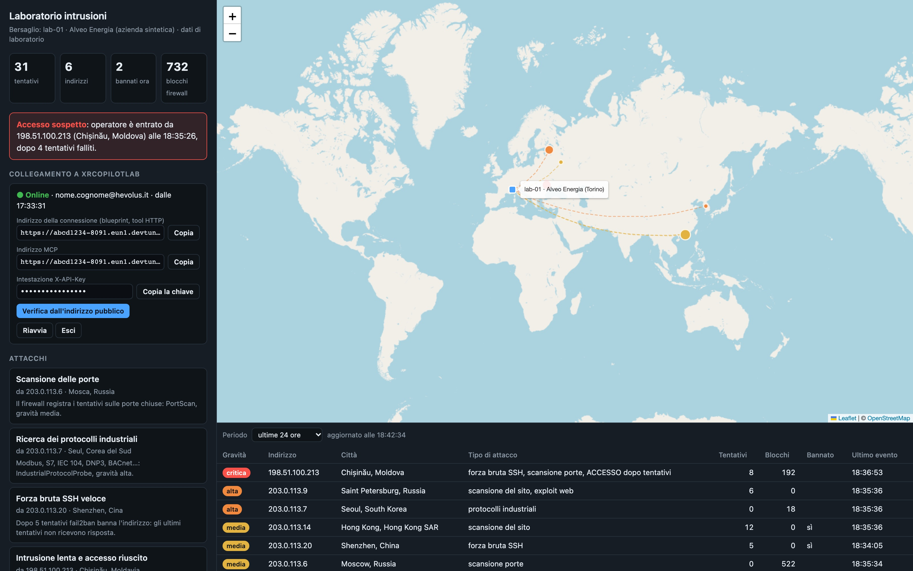

# Intrusion lab

A Docker lab for demos and tests: an Ubuntu 24.04 server (`lab-01`) with sshd, nginx, fail2ban and a firewall, on
which the **customer package** is installed by its own `install.sh` (same tarball as `make package`), and an attacker
that also serves the console on **http://localhost:8090**: attack buttons, and the map (OpenStreetMap) and table of
what the package on `lab-01` detects.



What each part of the console shows, and how to give the lab a public address for XRCopilotLab, in plain words:
[README › The test console](../README.md#the-test-console-docker-lab).

```bash
make lab-up      # builds and starts; creates lab/.env with the lab key on the first run
make lab-down    # stops the lab (keeps the tunnel login: same public address)
make lab-reset   # stops the lab and deletes all its state, tunnel login included
```

## What runs

The `make` commands use the service names (`make lab-shell SVC=attacker`); plain Docker uses the container names
(`docker exec -it intrusion-lab-01 bash`, `docker logs -f intrusion-lab-tunnel`).

| Service (container) | What | Notes |
|---|---|---|
| `lab-01` (`intrusion-lab-01`) | Ubuntu 24.04 with systemd: sshd (password login, user `operatore`), nginx (site, `/admin/` with basic auth, the package's API under `/intrusion-mcp/`), fail2ban (`sshd`, `nginx-http-auth`, `nginx-botsearch`, `nginx-limit-req`, `recidive`, times shortened), a UFW-like firewall, the package (`xrcopilotlab-intrusion-mcp.service`, logs mode) | privileged: systemd as PID 1, iptables. A lab container, never a pattern for production |
| `attacker` (`intrusion-lab-attacker`) | nmap, ssh, Python: fixed scenarios against `lab-01` only, and the console | its lab networks are `internal`: no attack reaches the internet |
| `tunnel` (`intrusion-lab-tunnel`) | Dev Tunnels CLI, socat, a small controller driven by the console | the only container that goes out to the internet, for the tunnel |

UFW logs through the kernel LOG target, which a container cannot read: the lab's firewall uses NFLOG, ulogd2 and
rsyslog to write **the same line** to `/var/log/ufw.log`, so the package's parser is the one a real host uses.

## Public address for XRCopilotLab (Dev Tunnels)

The `tunnel` container gives lab-01's API a public HTTPS address with Microsoft Dev Tunnels, so that a connection
in XRCopilotLab can call the lab running on a laptop. Nothing is installed on the Mac.

1. In the console, **Collegamento a XRCopilotLab › Accedi con l'account Microsoft**: the console shows Microsoft's
   link and a code; sign in there with an Entra ID (Hevolus), Microsoft or GitHub account.
2. The tunnel opens by itself (persistent, anonymous access, expires after 30 days unused) and the console shows its
   addresses: `…/api` for a connection with HTTP tools, `…/mcp` for an MCP client, and a button that copies the
   `X-API-Key`.
3. **Verifica dall'indirizzo pubblico** calls the package through the public address, as XRCopilotLab will.

What the tunnel reaches: only lab-01's port 8091, which serves `/api/` and `/mcp` and nothing else (its own nginx
logs, the firewall allows only the tunnel container). Anonymous access is needed because XRCopilotLab cannot log in to
Dev Tunnels: every call still needs the key. The login and the tunnel id live in the `tunnel-login` volume:
`make lab-down` keeps them (same address next time), `make lab-reset` deletes them.

Dev Tunnels has no price list; the limits are 5 GB of traffic and 10 tunnels per user per month. It is a preview
service for development and tests, not for a customer's server.

## Addresses and places

Three networks with documentation addresses (RFC 5737). The attacker adds its personas' addresses, and the package
places documentation addresses in the invented cities of the simulated mode (`DocumentationAwareGeo`); every other
address goes to DB-IP. So the map has cities, and no real address is ever involved.

| Scenario | From | Expected detection |
|---|---|---|
| Scansione delle porte | 203.0.113.6 (Moscow) | PortScan |
| Protocolli industriali | 203.0.113.7 (Seoul) | IndustrialProtocolProbe, High |
| Forza bruta SSH veloce | 203.0.113.20 (Shenzhen) | SshBruteForce, banned by `sshd` |
| Intrusione lenta e accesso | 198.51.100.213 (Chișinău) | PortScan, SshBruteForce, LoginAfterFailures, Critical |
| Scansione del sito | 203.0.113.14 (Hong Kong) | WebVulnerabilityScan, banned by `nginx-botsearch` |
| Exploit web | 203.0.113.9 (Saint Petersburg) | WebExploitAttempt, High |
| Forza bruta area riservata | 203.0.113.18 (São Paulo) | WebLoginBruteForce, banned by `nginx-http-auth` |
| Flood | 203.0.113.15 (Dallas) | RequestFlood, banned by `nginx-limit-req` |
| Campagna distribuita | 192.0.2.11–22 (12 cities) | DistributedSshBruteForce on `scada`, no ban |

All verified on 2026-11-11 with `make lab-up`, one scenario after the other.

## What the lab found in the package

- The single binary aborted at start on a host without ICU (`libicu`): `install.sh` now installs it when missing.
- With the default settings every log was read twice (the configuration list is appended to the defaults), so every
  attempt was counted twice: the file list is now de-duplicated.

## Secrets

`lab/.env` (git-ignored) holds `LAB_API_KEY`; `lab-01` stores only its hash, as `install.sh` does at a customer's, and
the console adds it to its calls, so the browser never sees it. `operatore`'s password and `/admin/`'s are lab values,
written in the scenarios on purpose: they exist only inside the lab.
